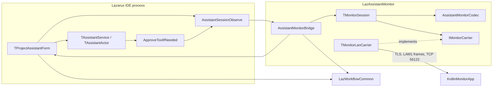
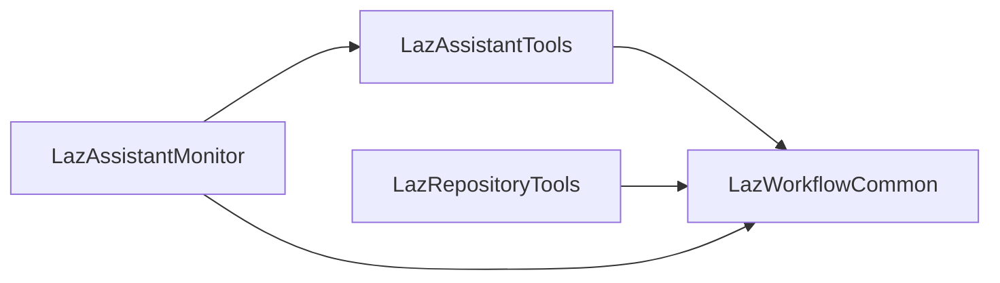
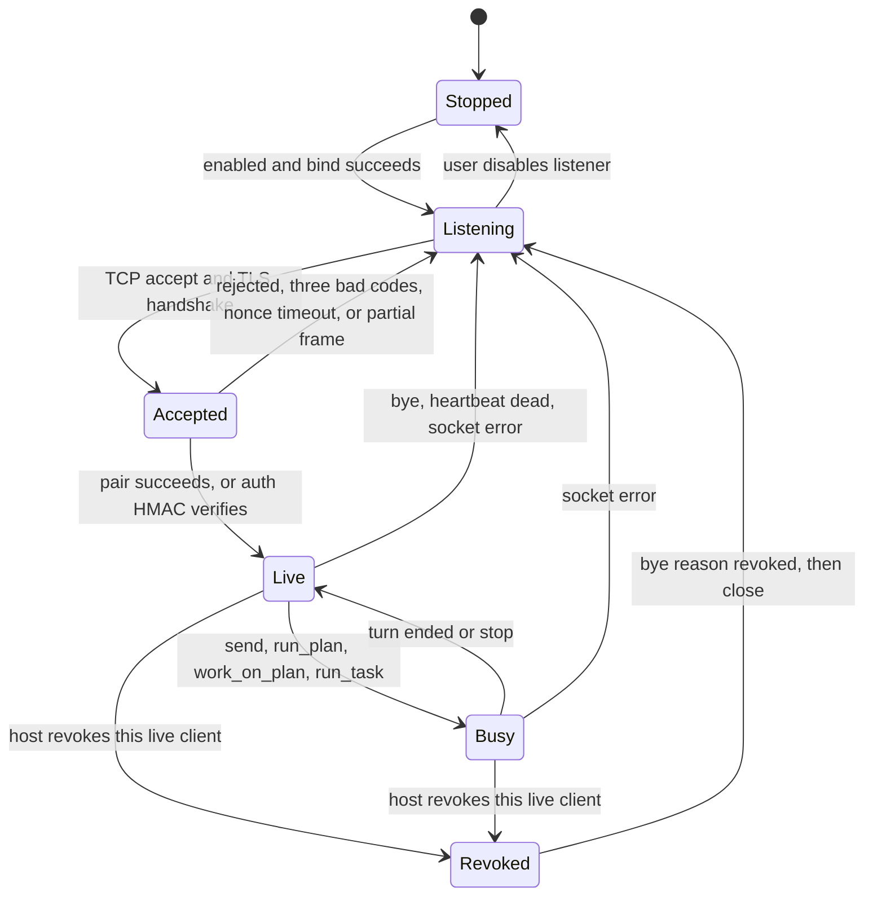

# LazAssistantMonitor and KotlinMonitorApp

| | |
| --- | --- |
| Author | Michell Computing |
| Date | 2026-10-19 |
| Status | Draft |
| Workspace | /home/paul/Projects/LazWorkflow |
| Packages | LazAssistantMonitor 0.1.0.0, LazAssistantTools (observer only), KotlinMonitorApp |

## Overview

LazAssistantMonitor is a new Lazarus package that exposes a network session for the Project Assistant already implemented by LazAssistantTools. The IDE remains the only process that talks to a model provider and the only process that runs tools. A paired client sends user actions (send, steer, stop, mode, plan, tasks, and, when the host allows it, an approval decision). The host streams the transcript, phase, status, plan list, and task list back.

The first client is KotlinMonitorApp, an Android application under `/home/paul/Projects/LazWorkflow/Source/KotlinMonitorApp`. It mirrors the Project Assistant surfaces: conversation transcript and streaming output, mode, prompt entry, steer while a turn is sending, stop, target display, plan list and the plan actions that are safe to invoke remotely, the task list, connection and model status, approval state, tool-call cards, images already stored for the transcript, and the error and disconnected states.

The first carrier is a direct LAN session: the IDE listens, the phone connects. The message catalogue and codec sit above a carrier seam so a later outbound connection to a web relay can carry the same messages. That relay, its accounts, and any public host are out of scope for this delivery.

LazAssistantTools must install, compile, and run with LazAssistantMonitor absent. The monitor package may depend on LazAssistantTools. LazWorkflowCommon stays unaware of the monitor catalogue.

## Background and Motivation

The Project Assistant already has a single-user IDE session. `TAssistantService` in `Source/LazAssistantTools/AssistantService.pas` owns history, `StartStream`, `CancelStream`, `EnqueueSteer`, and `SetActiveMode`. `TAssistantActor` in `Source/LazAssistantTools/AssistantActor.pas` runs the turn on a worker thread, drains `TAssistantSteerBuffer` at safe gaps, and posts trace events and stream snapshots to the main thread with `TThread.Queue`. `TProjectAssistantForm` in `Source/LazAssistantTools/ProjectAssistantForm.pas` is the session surface: mode combo (Chat, Inspect, Document, Plan, Build), send that becomes Steer while `FSending` is true, stop, target combo, plan sheet, tasks dialog, status footer, and the trace of thinking, tool, steer, subagent, and answer blocks.

That surface is bound to the machine running Lazarus. A phone next to the desk cannot read the live turn or send a steer without a channel the assistant package can ignore when it is not installed.

The suite already has the optional-package pattern this design follows. `Tests/AssistantOnlyInstall.lpr` links assistant units and leaves a repository section intact. `Tests/RepositoryOnlyInstall.lpr` links repository units and leaves `SuggestCommitMessageFunc` nil, so Suggest stays disabled. `Tests/IndependentInstallTest.lpr` saves one section and proves the other remains. `WorkflowSettings.WriteWorkflowSection` replaces one named section of `<primary config>/LazWorkflow.json` and keeps every other key. Paul's file is `/home/paul/.lazarus/LazWorkflow.json`. Sections in use today are `assistant` (`AssistantConfig.Save`), `assistant_tasks` (`AssistantTasksSection` in `AssistantTasks.pas`), `repository` (`GitConfig.pas`), and `spell` (`SpellCheckerConfig.pas`).

Low-level HTTP in this suite is already FCL. `AssistantHttps.pas` uses `fphttpclient`, `opensslsockets`, and `openssl`. `GrokOAuth.pas` accepts the OAuth redirect on `TInetServer` bound to `127.0.0.1:56121` (`GrokOAuthRedirectHost`, `GrokOAuthRedirectPort`). Host FPC is 3.3.1. `libssl.so.3` is present at `/usr/lib/x86_64-linux-gnu/libssl.so.3`. `TOpenSSLSocketHandler` in the FPC `opensslsockets` unit can accept TLS, generate a self-signed certificate (`CreateCertGenerator` / `CreateSelfSignedCertificate`), and expose the negotiated connection on the public `SSL` property.

The model-provider codec is `AssistantProtocol.pas`. The monitor uses a separate codec. Sharing that unit would mix OAuth-bearing provider JSON with a phone session.

Tests live under `/home/paul/Projects/LazWorkflow/Tests/`. The console pattern is `Tests/AssistantEventsTest.lpr`: `cthreads` on Unix, no `Interfaces` unit, no widgetset. `Tests/RunAssistantTests.pas` builds those programs with `fpc -MObjFPC` and a private `-FU` directory.

## Goals and Non-Goals

### Goals

- A RunAndDesignTime package `LazAssistantMonitor` whose sources are `/home/paul/Projects/LazWorkflow/Source/LazAssistantMonitor/` and whose package file is `/home/paul/Projects/LazWorkflow/Packages/LazAssistantMonitor.lpk`.
- A dormant observer and a small command surface owned by LazAssistantTools, with behaviour unchanged while no listener is registered.
- A versioned, transport-neutral message catalogue and a length-prefixed frame codec.
- One authenticated LAN controller, TLS, pairing, and revocation.
- Settings in a new `monitor` section of `LazWorkflow.json`, written with `WriteWorkflowSection` so a save replaces only that section.
- An Android client that is a practical mirror of the assistant tool and that builds without any Lazarus package.
- Console tests for the codec, the session rules, one loopback socket, and the assistant package compiling without the monitor package.

### Non-Goals

- A web relay, account system, public host, or internet transport. The carrier seam is specified. The relay is not scheduled.
- Reimplementing the model provider, tool runner, plan parser, or task expander on the phone.
- A second settings file, a second conversation store, or a second image store. The conversation-store clause is overridden for the phone's read-only replica only. See Catalogue version 2. A second settings file and a second image store stay non-goals.
- More than one simultaneous controller.
- Changing target, model, effort, approval mode, skills, or OAuth from the phone.
- Editor integration, file drop, clipboard paste, package compile commands, Review Compile, Review Build, and Fix Selected Message from the phone.
- Indy, Synapse, lNet, or any other third-party socket library.
- Hand-editing a generated `Packages/Laz*.pas` install stub.
- A Lazarus Default build mode, and build output under `Source/`.

## Key Decisions

1. **Observer lives in LazAssistantTools.** New unit `Source/LazAssistantTools/AssistantSessionObserve.pas`. A nil listener returns immediately. LazWorkflowCommon is unchanged and learns nothing about the catalogue. This matches `SuggestCommitMessageFunc` in `Source/LazWorkflowCommon/WorkflowEvents.pas`: the capability is a nil procedure until the optional package registers it, and the assistant-specific session stays in the assistant package.

2. **The IDE host remains the session.** The phone sends actions. `TAssistantService` and `TAssistantActor` still talk to the provider. `TProjectAssistantForm` still owns transcript paint, plan-agent state, and task application. The monitor package calls new public methods on that form and reads view records filled by the form.

3. **Codec is not `AssistantProtocol`.** Message types live in `AssistantMonitorCodec.pas` inside the monitor package. Provider JSON, OAuth tokens, API keys, and tool-execution credentials never appear in a monitor message.

4. **First carrier is host-listens LAN over FCL TLS.** `ssockets.TInetServer` plus `opensslsockets.TOpenSSLSocketHandler`, the same units `GrokOAuth.pas` and `AssistantHttps.pas` already use. fcl-web contains `TWebSocketServer`, and this FPC tree can build it. v1 still uses a raw length-prefixed frame on a TLS socket. The catalogue does not depend on a WebSocket upgrade, so a later relay can carry the same JSON on another carrier.

5. **TLS is required in v1.** A paired client can cause reads, writes, and tool runs against the work target. Cleartext on a LAN is the wrong default when OpenSSL 3 is already on the machine and `AssistantHttps.EnsureOpenSSLReady` already loads it. There is no cleartext fallback. The client pins the host certificate fingerprint before it sends the pairing code. That pin is the client's check that it reached the host whose fingerprint the user read. The host's compare of the echoed fingerprint is not a second factor: a peer that already finished TLS to this process can repeat the certificate the server just presented. The pairing code is the secret.

6. **Bind a chosen IPv4 address.** The default is the first private LAN address, not `0.0.0.0`. `GrokOAuth` already binds a specific address (`127.0.0.1`). When `bind_all` is true the listener binds `0.0.0.0` and a blank `bind_address` is ignored. When `bind_all` is false the listener requires one IPv4 address and refuses to start while that field is empty. The checkbox defaults off. Loopback is an explicit choice for an emulator using `adb reverse`.

7. **One controller.** `TSocketServer.MaxConnections` stays at -1. In `ssockets.pp` that property is a lifetime accept count ("Not the simultaneous connection count. -1 keeps accepting."), and `StartAccepting` leaves the loop once `NoConnections >= FMaxConnections`. The concurrent cap is `MaxSimultaneousConnections`, set to 2: the controller plus one socket that can carry `rejected`. `OnConnect` only registers the socket and returns. The accepted socket is then set non-blocking on both platforms: Unix `fpfcntl` preserves the existing flags, and Windows uses `ioctlsocket` with `FIONBIO`. Each `OnIdle` performs at most one `SSL.Read` and at most one `SSL.Write` on that socket and returns. `OnIdle` does not call `TSocketStream.Read`, `TSocketStream.Write`, `TOpenSSLSocketHandler.Recv`, or `TOpenSSLSocketHandler.Send`. `SSL_ERROR_WANT_READ` and `SSL_ERROR_WANT_WRITE` mean the same buffer is tried on the next idle. They leave the peer open. The heartbeat, the partial-frame timestamp, and the spare `rejected` write run on those later idles. When the controller drops, `StartAccepting` keeps running, so a reconnect after `bye` is accepted. A connection past the simultaneous cap is closed inside `StartAccepting` and reported with `DoConnectionDropped` before `OnConnect`. The spare socket that does reach `OnConnect` is not paired and receives no snapshot.

8. **Remote tool approval defaults off.** Until the host user enables `remote_approval` in the monitor section, an Ask-mode native tool still publishes one `approval_requested` with `decisions_accepted` false. The phone shows the sheet without Allow and Deny. A client `approval_decision` is rejected. `ApproveToolIfNeeded` queues that notice before `TThread.Synchronize` and calls `ClearAssistantApproval` with reason `desktop` when the dialog returns. The desktop path stays `MessageDlg` on the IDE thread, and the tool follows that yes or no. The waiter does not publish this display notice. Codex `TAssistantToolBroker.OnApproval` is set to nil in `ProjectAssistantForm.pas` (around the `BeginRun` setup) and stays nil. v1 remote approval covers the native tool loop only.

9. **A remote approval wait is cancellable, and timeout denies.** When remote approval is on, the waiter runs on the actor thread, waits at most 120 seconds, and a timeout is a denial. The waiter refuses to wait when it is already on the main thread, because `TAssistantService.ClearStreamThread` documents that `CheckSynchronize` off the main thread deadlocks a worker stuck in `Queue` or `Synchronize`. `TAssistantActor.Cancel` only calls `Terminate` and `AbortHttp` today, and `Detach` nils the service pointer while in-flight work can still finish and `ExecuteAssistantToolForMode` writes through `AssistantTarget`. The wait therefore arms a `TRTLEvent` through `AssistantSessionObserve`. Before `SignalAssistantApprovalWait`, the caller stores `aadAllow`, `aadDeny`, or `aadStopped` under the observer lock. `Cancel` stores `aadStopped` after `Terminate` and then signals. `Detach` stores `aadStopped` after `FServiceDetached` is visible and then signals. The waiter reads that stored value after `RTLEventWaitFor`. `aadNone` is not an allow; the waiter keeps waiting until a stored decision, an abort poll, or the 120 second timeout. The waiter slices the wait at about 200 ms and polls `Terminated`, `FTerminalNoted`, and `ServiceWasDetached`. Any of those is a denial with `approval_closed` reason `stopped`, including when the stored value is `aadAllow`. `RunOneTool` then does not queue `ExecuteOnMain` and does not call `ExecuteAssistantToolForMode`, so a phone or desktop Allow that arrives after Stop does not write, including while a newer turn is running. That return is what lets `ClearStreamThread` see `Finished` inside its 1.5 second pump instead of logging "Actor did not finish within 1.5s; detaching". Both the pre-dispatch waiter and the call inside `ApproveToolIfNeeded` receive the same `Call.Id`. Exactly one of them publishes. The armed wait is the only publish with `decisions_accepted` true. The display notice with `decisions_accepted` false is queued from `ApproveToolIfNeeded` alone.

10. **Target changes stay on the desktop.** `TAssistantWorkTarget` is the write root (`AllowsWrite`, `ScopeRefusal`, `SelectFolder`). The phone displays kind, caption, and root. It does not call `SelectFolder`, `SelectProject`, or `SelectPackage`.

11. **Images cross as refs, with a bounded fetch.** `AssistantImages.pas` stores pixels under `.assistant/images/` and keeps bytes out of `conversation.jsonl`. The snapshot carries id, name, mime, width, height, `DisplayPath`, and `Missing`. `Missing` comes from `AssistantImageDisplayPresent`, not from `TAssistantImageRef`. `image_get` resolves `turn_index` plus `image_id` to that display path and reads it with `ReadStoredAssistantImage`. Each `image_data` part holds at most 190000 decoded bytes so the base64 text plus the JSON envelope stays under the 262144-byte frame cap. A display file larger than 1 MiB, or a file the store refuses, returns `image_unavailable` and leaves the socket up. The 8 MiB store ceiling (`AssistantImageMaxFileBytes`) is a store limit, not a frame limit.

12. **Phone prompt text is text.** Attaching a new image stays on the desktop composer (`AttachImageAction`, `InputPanelDropFiles`, clipboard). The phone displays images already in the transcript.

13. **Android UI is Jetpack Compose.** The transcript is a state-driven list of thinking, tool, steer, subagent, answer, and image blocks. Compose matches that. The codec sits in a JVM module with no Android UI dependency so JUnit can test frames on a developer machine.

14. **Listener starts only when the user enables it.** The monitor section `enabled` field defaults false. Installing the package registers a menu and does not open a port.

## Proposed Design

### Component view



The forbidden edge is an arrow from LazAssistantTools, or from LazWorkflowCommon, to LazAssistantMonitor. `Packages/LazAssistantTools.lpk` keeps its current `RequiredPkgs`: LazStyledText, LazWorkflowCommon, IDEIntf, LCL, CodeTools, SynEdit. It gains source files. It does not gain a package dependency.

`TProjectAssistantForm` is not a singleton. The bridge finds it by scanning `Screen.CustomForms` for a form of that class that is not `csDestroying`, the same scan as `AssistantHostTurnOrPlanActive`. When the window is closed the bridge returns `error` / `no_session` and the message "The Project Assistant window is not open." The listen thread and the queued command do not call `CreateProjectAssistantForm` or `IDEWindowCreators.ShowForm`. Snapshot and command calls stay on the main thread after that lookup.



### Package layout

`Packages/LazAssistantMonitor.lpk` follows `Packages/LazRepositoryTools.lpk` and `Packages/LazAssistantTools.lpk`:

- `Type` = `RunAndDesignTime`
- `Author` = `Michell Computing`
- `License` = `LGPL-2.1-or-later with static linking exception`
- `Version` Major 0, Minor 1, Release 0, Build 0
- `SmartLinkUnit` = True
- `UnitOutputDirectory` = `../Lib/$(TargetCPU)-$(TargetOS)/LazAssistantMonitor`
- `OtherUnitFiles` = `../Source/LazAssistantMonitor`
- Register unit `../Source/LazAssistantMonitor/RegLazAssistantMonitor.pas` with `HasRegisterProc` true
- Required packages: `LazAssistantTools`, `LazWorkflowCommon`, `LCL`, `IDEIntf`
- No Default build mode

FCL units (`ssockets`, `opensslsockets`, `openssl`, `fpjson`, `fpsha256`) come from the compiler unit path. They are not Lazarus package dependencies. `AssistantHttps.pas` already uses that set without an extra lpk entry.

The register unit stays in `Source/`. Lazbuild may generate `Packages/LazAssistantMonitor.pas`. That stub is not hand-edited.

Unit split, each intended to stay under about 1000 lines:

| Unit | Role | UI |
| --- | --- | --- |
| `RegLazAssistantMonitor.pas` | `Register` calls `RegisterAssistantMonitor` | No |
| `AssistantMonitorMain.pas` | IDE menu, owns the listener thread and the options form | LCL, because it registers an IDE menu |
| `AssistantMonitorCodec.pas` | JSON message catalogue, version 1 | No |
| `AssistantMonitorFrames.pas` | `LAM1` framing | No |
| `AssistantMonitorSession.pas` | State machine, pairing, HMAC, one controller, revoke | No |
| `AssistantMonitorCarrier.pas` | `IMonitorCarrier` seam | No |
| `AssistantMonitorLan.pas` | `TInetServer` listen thread, bind, heartbeat, backpressure | No |
| `AssistantMonitorTls.pas` | Certificate files, fingerprint, handler, version check | No |
| `AssistantMonitorSettings.pas` | `monitor` section read and write | No |
| `AssistantMonitorBridge.pas` | Main-thread command pump, snapshot pull, coalesce | Calls LCL forms only through queued methods |
| `AssistantMonitorApproval.pas` | Remote approval waiter | No |
| `AssistantMonitorForm.pas` + `.lfm` | Listener, endpoint, clients, revoke | LCL. Static form, `TActionList`, no `CreateUI`. No pairing code during open-LAN bring-up. |

LCL is required for `TAssistantMonitorForm` and for `MenuIntf` / `IDECommands` registration, the same reason `AssistantMain.pas` uses LCL. The listen thread's uses clause is FCL only. A GUI unit inside `AssistantMonitorLan.pas` would be a defect.

The options form is `TAssistantMonitorForm`, an IDE dialog in the style of `TAssistantSettingsForm` and `RegLazAssistantTools`. It is not a Template-repo `TMainForm`. Controls have no `F` prefix. Streamed fields and designer-wired events live in the unnamed first section. There is no trailing published section.

IDE install command, matching the Qt5 primary config:

```text
/home/paul/Projects/FreePascal/Lazarus/lazbuild --ws=qt5 --pcp=/home/paul/.lazarus Packages/LazAssistantMonitor.lpk
```

A gtk3 lazbuild of this package against `/home/paul/.lazarus` would retarget the IDE's compiled units. The disposable package check in `Tests/RunAssistantTests.pas` uses `--ws=gtk3` and a private `--pcp`. That path may build the monitor lpk into a temp config. It must not be pointed at `/home/paul/.lazarus`.

LazAssistantMonitor is RunAndDesignTime and is installed as a static IDE package, the same way LazAssistantTools is static. The running IDE loads the menu, the options form resource, and any change to `ProjectAssistantForm` only after Tools > Build Lazarus and a restart. Enabling the listener is then a command in the new menu. It does not require another rebuild.

### Observer API

New unit owned by LazAssistantTools. With no listener registered, `AssistantSessionObserve` returns at the assigned check. Callers do not build a snapshot first.

```pascal
Unit AssistantSessionObserve;

{ Dormant session observer for an optional monitor package.
  A nil listener changes nothing. (c) 2026 Michell Computing. }

{$IFDEF FPC}
  {$MODE ObjFPC}
  {$LONGSTRINGS ON}
{$ENDIF}

Interface

Uses
  Classes, SysUtils, SyncObjs;

Type
  TAssistantSessionNoticeKind = (
    asnTranscript,
    asnPhase,
    asnMode,
    asnTarget,
    asnPlan,
    asnTasks,
    asnStatus,
    asnApproval,
    asnSession,
    asnError
  );

  TAssistantSessionListener = Procedure(Kind: TAssistantSessionNoticeKind) Of Object;

  TAssistantMonitorImage = Record
    Id: String;
    Name: String;
    Mime: String;
    Width: Integer;
    Height: Integer;
    DisplayPath: String;
    Missing: Boolean;
  End;

  TAssistantMonitorBlock = Record
    Kind: String;       { user, thinking, tool, answer, note, steer, subagent, worked }
    BlockId: String;
    Title: String;
    ToolName: String;
    ToolId: String;
    Body: String;
    Running: Boolean;
    Ok: Boolean;
    DurationMs: Integer;
    Images: Array Of TAssistantMonitorImage;
  End;

  TAssistantMonitorTurn = Record
    TurnIndex: Integer; { -2 matches LiveConversationMarker on the form; stored turns are >= 0 }
    Id: String;
    Mode: String;
    Prompt: String;
    Thinking: String;
    Response: String;
    ErrorText: String;
    CreatedAt: String;
    DurationMs: Integer;
    PromptPreview: String;
    Live: Boolean;
    Blocks: Array Of TAssistantMonitorBlock;
    Images: Array Of TAssistantMonitorImage;
  End;

  TAssistantMonitorPlanRow = Record
    Index: Integer;
    Level: Integer;
    Title: String;
    ParentTitle: String;
    Status: String;
    Actionable: Boolean;
  End;

  TAssistantMonitorTaskRow = Record
    Id: String;
    Title: String;
    Summary: String;
    Mode: String;
    Kind: String;       { prompt or format }
    Scope: String;
    CompileFirst: Boolean;
    Enabled: Boolean;
    NeedsNote: Boolean;
  End;

  TAssistantMonitorView = Record
    Available: Boolean;
    Busy: Boolean;
    Sending: Boolean;
    ModeLocked: Boolean;
    PlanRunning: Boolean;
    Mode: String;
    Phase: String;
    StatusText: String;
    Model: String;
    Backend: String;
    SignedIn: Boolean;
    ApprovalCaption: String;
    Effort: String;
    Skill: String;
    ContextText: String;
    TargetKind: String;
    TargetDisplay: String;
    TargetRoot: String;
    PlanPath: String;
    PlanTitle: String;
    CanSend: Boolean;
    CanSteer: Boolean;
    CanStop: Boolean;
    CanChangeMode: Boolean;
    RemoteApproval: Boolean;
    ErrorText: String;
  End;

  TAssistantApprovalNotice = Record
    Active: Boolean;
    ToolId: String;
    ToolName: String;
    Summary: String;
    ModeCaption: String;
    DecisionsAccepted: Boolean;
  End;

  { aadNone means no answer is stored. A bare signal leaves this value. }
  TAssistantApprovalDecision = (
    aadNone,
    aadAllow,
    aadDeny,
    aadStopped);

{ Main thread only. }
Procedure SetAssistantSessionListener(Listener: TAssistantSessionListener);
Function AssistantSessionListenerAssigned: Boolean;
{ Returns False immediately when the listener is nil. }
Function AssistantSessionObserve(Kind: TAssistantSessionNoticeKind): Boolean;

{ Main thread notifies before return. Any other thread queues. }
Procedure PublishAssistantApproval(Const Notice: TAssistantApprovalNotice);
{ Always queues, including when the caller is already on the main thread. }
Procedure QueueAssistantApproval(Const Notice: TAssistantApprovalNotice);
Procedure ClearAssistantApproval(Const ToolId, Reason: String);
Function CurrentAssistantApproval: TAssistantApprovalNotice;

{ Main-thread modal depth. A queued monitor command that sees a depth above
  zero returns host_busy and does not call the form. The approval notify
  is not that command. }
Procedure BeginAssistantModal;
Procedure EndAssistantModal;
Function AssistantModalDepth: Integer;

{ Stores the event and resets the stored decision to aadNone.
  Nil event is a no-op. The actor never names the monitor package. }
Procedure ArmAssistantApprovalWait(Event: PRTLEvent);
{ Writes only while the stored decision is aadNone. }
Procedure StoreAssistantApprovalDecision(Decision: TAssistantApprovalDecision);
Function ReadAssistantApprovalDecision: TAssistantApprovalDecision;
Procedure SignalAssistantApprovalWait;

Implementation
```

`SyncObjs` is in the interface uses clause because `ArmAssistantApprovalWait` takes a `PRTLEvent`. The unit still does not name LazAssistantMonitor. `SetAssistantSessionListener` and `AssistantSessionObserve` copy the method pointer under a `TRTLCriticalSection` and call the listener outside the lock. Both are documented as main-thread operations. `PublishAssistantApproval`, `QueueAssistantApproval`, and `ClearAssistantApproval` store the notice under that lock. `PublishAssistantApproval` notifies the listener before returning when the caller is on the main thread, and `TThread.Queue`s the notify from any other thread. The armed waiter uses that procedure. It runs on the actor thread, so the notify is queued, and `DecisionsAccepted` is true. `QueueAssistantApproval` always `TThread.Queue`s the notify, including when the caller is already on the main thread. It does not call the listener inline. `ApproveToolIfNeeded` uses it for the display notice. The bridge registers on the main thread from `RegisterAssistantMonitor`. The form calls `AssistantSessionObserve` from paths that already run on the main thread:

- `TProjectAssistantForm.StreamToken` and `HandleTraceEvent` (`asnTranscript`, `asnPhase`)
- `SelectMode` (`asnMode`)
- `ApplyTarget` (`asnTarget`)
- `RefreshBuildTodos` and plan-agent start/stop (`asnPlan`)
- `UpdateStatusFooter` (`asnStatus`)
- `FinishAssistantReply` and the cancel path in `StopStream` (`asnTranscript`, `asnError`, `asnStatus`)
- form create and destroy (`asnSession`)
- `SaveAssistantTasks` in `AssistantTasks.pas`, after `WriteWorkflowSection(AssistantTasksSection, ...)` returns true (`asnTasks`). `AssistantTasksSection` is `assistant_tasks`. The only caller today is `TAssistantTasksForm.SaveIfDirty` (`AssistantTasksForm.pas`), which runs on the main thread. `RemoteRunTask` does not change a task's `Enabled` flag, so it does not raise `asnTasks`.

`BeginAssistantModal` and `EndAssistantModal` adjust a counter under the same lock. `AssistantModalDepth` reads it. `TToolApprovalAsk.Ask` in `AssistantTools.pas` already wraps `MessageDlg`. PR 4 routes `MessageDlg` and `InputQuery` on `TProjectAssistantForm` through `RunAssistantModal`, which calls `BeginAssistantModal` before the dialog and `EndAssistantModal` in `Finally`. A nil listener does not change that counter.

`ArmAssistantApprovalWait` stores the event pointer under the lock and sets the stored decision to `aadNone`, so an `aadStopped` left by an earlier `Cancel` does not answer the new wait. `StoreAssistantApprovalDecision` writes under that lock only while the stored value is `aadNone`. A second store leaves the first decision in place. `SignalAssistantApprovalWait` copies the event and sets it outside the lock. A nil event returns immediately. The signal carries no decision. The waiter calls `ReadAssistantApprovalDecision` after `RTLEventWaitFor` and treats `aadNone` as "keep waiting". `TAssistantActor.Cancel` calls `StoreAssistantApprovalDecision(aadStopped)` after `Terminate`, then `SignalAssistantApprovalWait`. `TAssistantActor.Detach` does the same store after `FServiceDetached` is visible, then signals. Phone Allow and Deny, and the monitor form's Allow and Deny, store `aadAllow` or `aadDeny` and then signal. They do not call `ExecuteAssistantToolForMode`. The monitor package is not in the actor's uses clause.

`TAssistantActor.NotifyTrace` and `NotifyMain` already run on the main thread via `TThread.Queue` (`QueueTrace` queues `NotifyTrace`; `EmitSnapshot` queues the token callback). The observer is invoked from the form handlers those callbacks reach, not from the actor thread.

`TAssistantService.OnTrace` stays the form's trace handler. The monitor does not replace it. Replacing it would drop `TAssistantTrace.ApplyEvent` updates inside the form.

View fill methods are public on `TProjectAssistantForm` and main-thread only. They copy strings into the records above. They do not write JSON and they do not read `TAssistantConfig.AccessToken`, `RefreshToken`, or `GrokOAuthClient` token fields. `SignedIn` is the boolean already shown by `UpdateStatusFooter` (`AssistantChatConfig.IsSignedIn`, or a live Codex/Claude runtime). `ApprovalCaption` is `ApprovalModeCaption` of the active approval string. `TargetDisplay`, `TargetKind`, and `TargetRoot` come from `AssistantTarget` (`DisplayName`, `Kind`, `Root`).

Turn fill uses `TAssistantConversationStore.GetTurn` and `TAssistantTrace` blocks (`tbkUser`, `tbkThinking`, `tbkTool`, `tbkAnswer`, `tbkNote`, `tbkSteer`, `tbkSubagent`, `tbkWorked`). `TurnIndex` `-2` is the existing `LiveConversationMarker`. Filling an older turn reads the store and does not change `FSelectedTurnIndex`, so the phone can browse history while the desktop stays on the live row.

Image rows copy `Id`, `Name`, `Mime`, `Width`, `Height`, and `DisplayPath` from `TAssistantImageRef`. `Missing` is not a field of that record. The fill sets it from `AssistantImageDisplayPresent`. The phone may ignore `DisplayPath`. `RemoteImage` uses it on the host to open the display file, not `UploadPath`. `AssistantImageMaxAttachments` is 8. Pixel bytes stay out of `conversation.jsonl`.

`CanSend` is true only when `FSending` is false and `FPlanAgentRunning` is false. `CanSteer` is true only while `FSending` is true and the active backend accepts steer (native `EnqueueSteer` or Codex). Claude and a transport wait leave `CanSteer` false. `CanStop` is `FSending`. `CanChangeMode` is false while `FSending` or `FModeLocked`. `Busy` is `FSending` or `FPlanAgentRunning`. Between plan-agent packages `FSending` is false, so `CanSteer` is false and the phone must not offer Steer. `SendAction.Enabled` stays true while the caption flips to Steer; the phone does not copy that caption. It uses `can_send`, `can_steer`, and `can_stop`.

Plan rows come from the form's `BuildSections` list of `TPlanSection` (`Title`, `Status`, `HeadingLevel`, `Actionable`, `ParentTitle`) and from `GetActivePlanRelativePath`. Task rows come from `LoadAssistantTasks`. `NeedsNote` uses `AssistantTaskNeedsUserNote`.

### Host commands

Public methods on `TProjectAssistantForm`, main-thread only. Each returns `False` and an `ErrorText` the bridge can put in an `error` message. They do not call `MessageDlg`, `InputQuery`, or `SettingsActionExecute`. The existing click handlers keep their dialogs. The remote methods are new helpers. They are not calls through `NewPlan`, `RunPlan`, `BuildWorkOnSelectedPackage`, `PrepareAssistantTaskRun`, `SteerQueuedText`, or `ApplyPreparedTaskRequest` except where a row below names that call after the dialog-free checks.

The bridge finds the form the way `AssistantHostTurnOrPlanActive` does: it scans `Screen.CustomForms` for a `TProjectAssistantForm` that is not `csDestroying`. The form is not a singleton. When none is open the bridge returns `error` / `no_session` with message "The Project Assistant window is not open." It does not call `CreateProjectAssistantForm` or `IDEWindowCreators.ShowForm` from the listen thread or from the queued command. Snapshot and command calls run on the main thread after that lookup, and only after the generation and modal-depth checks below.

| Method | Dialog-free helper | Remote rule |
| --- | --- | --- |
| `RemoteSubmit` | `SubmitUserTextEx` when `FSending` is false | Text only. Empty text fails. An unsigned-in native provider returns `ErrorText` "Sign in with SuperGrok / X Premium in Settings before sending." That is the sentence in `SendActionExecute`. The helper does not call `SettingsActionExecute`. |
| `RemoteSteer` | native `AssistantClient.EnqueueSteer`, or `FCodexRun.Steer` | Only while `FSending`. Otherwise `ErrorText` is "Nothing is running to steer." Claude or a transport wait returns "This connection cannot steer." A Codex failure returns `FCodexRun.LastSteerError`. The helper does not assign `InputMemo`. `SteerQueuedText` writes the memo on those failures; the remote path does not call it. |
| `RemoteStop` | `StopStream` | Idempotent when not sending. |
| `RemoteSelectMode` | `SelectMode` | Rejected while `FSending` or `FModeLocked`, which is what `ModeComboChange` already enforces by restoring the combo. |
| `RemoteNewConversation` | `StartNewChat(False, False)` | Rejected while sending or while `FPlanAgentRunning`. Keeps the mode already selected, the same as the desktop New button. |
| `RemoteSelectPlan` | active-plan choice change | Rejected while sending (`ActivePlanCombo.Enabled` is already false then). |
| `RemoteNewPlan` | writes the plan file itself | See the plan helpers below. Does not call `NewPlan`. |
| `RemoteRemovePlan` | `RemoveAvailableAssistantPlan` | `host_busy` while `FSending` or `FPlanAgentRunning`. An empty selection returns "Select a plan to remove from the list." The Markdown file stays on disk. |
| `RemoteWorkOnPlan` | the work-on helper below | Does not call `BuildWorkOnSelectedPackage`. |
| `RemoteRunPlan` / `RemoteStopPlan` | the run helper below / `StopRunPlan(preUserStop, ...)` | Stop does not ask the confirmation in `RunPlanActionExecute`. `StopRunPlan` itself does not confirm. |
| `RemoteRunTask` | kind checks, then `PrepareAssistantTaskRunWithNote`, then `ApplyPreparedTaskRequest` for `trkRun` | See task rules below. |
| `RemoteInsertTask` | kind checks, then `PrepareAssistantTaskRunWithNote` for `trkInsert` | Returns `ApiText` as `insert_result`. Does not call `ApplyPreparedTaskRequest`, which writes `InputMemo` and shows "Replace the composer text with this task?". `host_busy` while `FSending` or `FPlanAgentRunning`. |
| `RemoteTurn` | `GetTurn` | Does not change the desktop selection. |
| `RemoteImage` | resolve `turn_index` + `image_id` to `DisplayPath`, then `ReadStoredAssistantImage` | The ref must belong to a turn the view already exposed. The file read is the display file, not the upload derivative. |

`RemoteNewPlan` takes an optional `title` from the payload. An empty or missing title becomes "Project Plan", the same default `NewPlan` assigns before `InputQuery`. There is no `InputQuery`. The helper is rejected while sending, matching `NewPlanAction.Enabled`. It calls `WriteMarkdownFile` with `OpenAfter` false, so the Markdown window stays a desktop action. A `WriteMarkdownFile` failure returns that function's `Err` as `ErrorText` and does not call `MessageDlg`.

`RemoteRunPlan` returns these sentences as `ErrorText` and does not call `MessageDlg`:

- `FSending` or `FPlanAgentRunning`: "Wait for the current reply to finish before starting Run Plan."
- not `RunPlanIsAvailable`: "Set an active plan first."
- no incomplete section: `AssistantPlanRunStartMessage(CollectPlanRunReportFacts(preCleanFinish, ''))` from `AssistantPlanRun.pas`. When nothing runnable remains, that text includes `AssistantPlanRunBlockedLeft` ("Blocked items need the listed actions. No unblocked item is left.").

`RemoteWorkOnPlan` still writes `Status: in progress` through `SetPlanSectionStatus` when the section is not-started, unknown, or blocked, which is what `BuildWorkOnSelectedPackage` does before the prompt. That write is not a phone mark-complete control. v1 has no remote mark-complete command. The streamed plan controls stay New, Run, Open, and Remove. There is no Done button. The helper returns `ErrorText` and does not call `MessageDlg`:

- `FSending`: "Wait for the current reply to finish (or Stop) before starting work."
- empty plan: "Set an active plan on the Plan tab first."
- bad selection: `BuildSelectionMessage`, which is "Select an actionable item (### with Status), not a section heading." or "Select an actionable item in the list."
- `SetPlanSectionStatus` failure: "Could not set status to in progress:" plus `LineEnding` plus `Err`. The helper still continues, as the desktop does after that warning.
- `GetPlanSectionBody` failure: "Could not load plan section:" plus `LineEnding` plus `Err`, and the helper returns false.

`RemoteStop` runs on the main thread because `TAssistantService.ClearStreamThread` pumps `PumpPluginSynchronize` only when `RunningOnMainThread` is true, and the comment there forbids `CheckSynchronize` from a worker. The LAN thread uses `TThread.Queue`, not `Synchronize`.

Each queued command carries a generation and a `Cancelled` flag under a lock, plus a `Claimed` flag. The queued method sets the completion event in `Finally`. It calls the form only when, under the lock, `Cancelled` is still clear and `AssistantModalDepth` is zero, and it then sets `Claimed`. On timeout (5 seconds) the LAN thread sets `Cancelled` under the lock when `Claimed` is still false, then sends `error` / `host_busy`. When `Claimed` is already true it does not also send `host_busy`, because the form call is already running. A command whose `Cancelled` flag is set by the time the queue runs does not call the form.

Lazarus modal loops pump `CheckSynchronize`, so a `TThread.Queue` method runs reentrantly inside `MessageDlg` rather than waiting out the dialog. The 5-second wait is the non-pumping stall, when the main thread is not pumping. It is not the modal case. `RunAssistantModal` raises `AssistantModalDepth` around `MessageDlg` and `InputQuery` on `TProjectAssistantForm`, and around `TToolApprovalAsk.Ask`. The queued method reads that depth before the form call. A depth above zero returns `host_busy` immediately and does not call the form. That is the guard against `RemoteStop` reentering `ClearStreamThread` from inside an approval dialog. Do not describe that case as a 5-second wait. The display-only `approval_requested` is a separate `TThread.Queue` of the observer notify, posted before that dialog. It is not a host command, so a depth above zero does not drop it. The pump inside `MessageDlg` delivers it before the dialog returns.

Task rules for v1:

- `RemoteRunTask` and `RemoteInsertTask` reject `tkFormat` with "Format tasks run on the desktop editor." and `CompileFirst` with "Tasks that compile first run on the desktop." before `PrepareAssistantTaskRun` or `PrepareAssistantTaskRunWithNote`. `PrepareAssistantTaskRun` calls `TryApplyFormat` for `tkFormat` and `CompileLikeReview` for `CompileFirst` before any later kind check would help.
- Other `tkPrompt` tasks run on the host. The host collects evidence with the existing helpers in `AssistantTaskRun.pas` (`FillEditorEvidence`, `CollectSavedDiff`, `ReadMessages`).
- `tsUserNote` takes the note from the client message. `PrepareAssistantTaskRunWithNote` skips `AskForNote` / `ShowAssistantTaskNote`. An empty note fails with "A note is required."
- Hidden or disabled tasks fail with the strings `PrepareAssistantTaskRun` already uses: "This task is hidden." and "This task is disabled."
- A busy host fails with the existing `HostIsBusy` text. The default when the query returns no sentence is "Wait for the current reply to finish."
- `RemoteRunTask` calls `ApplyPreparedTaskRequest` only for `trkRun`. `RemoteInsertTask` returns the expanded `ApiText` and stops.

Plan actions that rewrite an item's `Status:` line, other than the in-progress write inside `RemoteWorkOnPlan`, stay with the model (`update_markdown`) or with the desktop. `SetPlanSectionStatus` remains a host-side helper. It is not a phone button.

`Busy` mirrors `FSending` or `FPlanAgentRunning`. The phone may `steer` and `stop` in `Busy` only when `can_steer` or `can_stop` is true, not merely because the view is busy. `send`, `set_mode`, `new_conversation`, `run_plan`, `work_on_plan`, and `run_task` fail with `error` / `host_busy` while the matching desktop control is disabled. `remove_plan` and `insert_task` fail with `host_busy` while `FSending` or `FPlanAgentRunning`. That is slightly stricter than `SetSending`, which disables `RemovePlanAction` only while a turn is sending. `select_plan` and `new_plan` follow `SetSending`, which disables the plan combo and New Plan while a turn is running. `CanSend` is also false while `FPlanAgentRunning`.

### Message catalogue

Codec version is the integer `1`. Every JSON object has `v`, `id`, and `type`. `id` is a client-generated or host-generated correlation string, at most 64 characters, restricted to the task-id character set (`TaskIdIsSafe` rules: letters, digits, `.`, `_`, `-`). `payload` is an object. Unknown `type` values produce `error` with `reason` `unknown_type` and do not change session state.

Wire names are snake case. Pascal enums stay in the units above; the codec maps them.

#### Session setup

| Type | Direction | Payload | Host effect |
| --- | --- | --- | --- |
| `hello` | client to host | First connection: `client_name`, `client_version`. Reconnect: those two plus `client_id`. | Does not enter `Live`. A first connection has no `client_id`. No transcript is sent. |
| `pair` | client to host | `code`, `fingerprint` | Checked against the in-memory code. The fingerprint compare only detects a client that pinned a different certificate. It is not a second factor. |
| `pair_ok` | host to client | `client_id`, `session_token` | Frame the host sends after `pair` has already succeeded. The frame name is not the transition. Sent once. The token is the monitor credential. |
| `hello_ok` | host to client | `nonce`, `server_name` | Only after a `hello` that carried `client_id`. `nonce` is 16 bytes from `CryptoGetRandomBytes`, hex. Single use, 30 seconds. |
| `auth` | client to host | `client_id`, `hmac` | HMAC-SHA256 of the host nonce, keyed by the stored session token. Verifying `auth` is what enters `Live` on a reconnect. |
| `rejected` | host to client | `reason`, `host_version`, `client_version` | Socket closes after this frame. A new socket whose `client_id` is already revoked uses `rejected` / `revoked`. |
| `bye` | either | `reason` | Clean close. `bye` / `revoked` is only for a socket that was already `Live` or `Busy` when the user revoked it. |

`rejected.reason` is one of `protocol`, `pair_code`, `fingerprint`, `expired`, `auth`, `revoked`, `busy`, `disabled`.

#### Steady state

| Type | Direction | Payload | Host effect |
| --- | --- | --- | --- |
| `snapshot` | host to client | `view`, `turns` (index), `live` (full turn), `plan` (path, title, rows), `tasks` (rows), `approval` | Built on the main thread after auth and whenever the client sends `refresh`. |
| `refresh` | client to host | empty object | Queues a new snapshot. |
| `transcript` | host to client | `turn_index`, `revision`, `blocks`, `phase`, `status_text` | Latest full live blocks. The client replaces the live turn. |
| `turn` | client to host | `turn_index` | `RemoteTurn`. |
| `turn_data` | host to client | one `TAssistantMonitorTurn` | |
| `mode` | host to client | `mode`, `locked` | |
| `set_mode` | client to host | `mode` (`inspect`, `document`, `plan`, `build`, `chat`) | `RemoteSelectMode`. |
| `send` | client to host | `text` | `RemoteSubmit`. |
| `steer` | client to host | `text` | `RemoteSteer`. |
| `stop` | client to host | empty object | `RemoteStop`. |
| `status` | host to client | the status fields of `TAssistantMonitorView` | |
| `target` | host to client | `kind`, `display`, `root` | Display only. |
| `plan` | host to client | `path`, `title`, `running`, `rows` | |
| `select_plan` | client to host | `path` | `RemoteSelectPlan`. |
| `new_plan` | client to host | optional `title` | `RemoteNewPlan`. Empty or missing `title` becomes "Project Plan". |
| `remove_plan` | client to host | `path` | `RemoteRemovePlan`. |
| `work_on_plan` | client to host | `index` | `RemoteWorkOnPlan`. |
| `run_plan` | client to host | empty object | `RemoteRunPlan`. |
| `stop_plan` | client to host | empty object | `RemoteStopPlan`. |
| `tasks` | host to client | `rows` | |
| `run_task` | client to host | `id`, `note` | `RemoteRunTask`. |
| `insert_task` | client to host | `id`, `note` | `RemoteInsertTask`. |
| `insert_result` | host to client | `text` | Phone composer text. Desktop composer unchanged. |
| `approval_requested` | host to client | `tool_id`, `tool_name`, `summary`, `mode_caption`, `decisions_accepted` | False on the one display notice `ApproveToolIfNeeded` queues before the Ask dialog. True only on the armed-wait publish. |
| `approval_decision` | client to host | `tool_id`, `allow` | Applied only when `decisions_accepted` was true and the id is still pending. The handler stores `aadAllow` or `aadDeny` and then signals. |
| `approval_closed` | host to client | `tool_id`, `reason` (`allowed`, `denied`, `finished`, `timeout`, `desktop`, `disabled`, `stopped`) | `desktop` is produced when that Ask dialog returns. `stopped` is a stored `aadStopped`, or `Terminated`, `Detach`, or `FTerminalNoted`. |
| `image_get` | client to host | `turn_index`, `image_id` | `RemoteImage`. |
| `image_data` | host to client | `image_id`, `mime`, `width`, `height`, `part`, `part_count`, `revision`, `bytes_base64` | At most 190000 decoded bytes in one part. |
| `image_unavailable` | host to client | `image_id`, `reason` (`missing`, `too_large`, `refused`) | The socket stays up. |
| `new_conversation` | client to host | empty object | `RemoteNewConversation`. The new conversation stays in the mode already selected. |
| `error` | host to client | `reason`, `message`, `ref` | `ref` is the client message id. |
| `ping` | either | `ticks` | |
| `pong` | either | `ticks` | |

`snapshot.turns` carries index rows only: `turn_index`, `id`, `mode`, `created_at`, `prompt_preview`, `error_text`. The newest 30 stored turns are included, plus the live turn in `live`. Older rows are omitted from v1; the desktop history combo remains the way to reach archived conversations. Overridden for the phone replica only: a disconnected phone can open a cached conversation. The desktop history combo remains the host store. See Catalogue version 2. `prompt_preview` is the store's existing `PromptPreview`.

`transcript.blocks[].body` for a tool card is capped at `MaxToolEventChars` (4000, `AssistantActor.pas`). The block gains `truncated: true` when the form's trace body was longer. Answer and thinking bodies are the full snapshots `TAssistantStreamEvent` already delivers, split across frames when one body exceeds 200000 bytes. Each part has `part`, `part_count`, and `revision`.

`image_data` uses the same part fields. One part holds at most 190000 decoded bytes. Base64 of that size is `4 * ceil(190000 / 3)` = 253336 characters. With about 8 KiB of JSON envelope the frame stays under the 262144-byte payload cap (253336 + 8192 = 261528). The total decoded budget for one `image_get` is 1 MiB (1048576 bytes). A display file larger than that budget, or a file the store refuses, returns `image_unavailable` and does not close the socket. `too_large` is the reason when the file is over the budget. `missing` is the reason when `AssistantImageDisplayPresent` is false or `ReadStoredAssistantImage` reports the file missing. `refused` is the reason when the path is outside the image directory or is a symbolic link. `AssistantImageMaxFileBytes` (8 MiB) is the store limit inside `ReadStoredAssistantImage`, not a frame limit. A file the store accepts and that is at most 1 MiB is split into parts of at most 190000 decoded bytes.

`error.reason` includes `unknown_type`, `payload_too_large`, `host_busy`, and `no_session`. `no_session` uses the message "The Project Assistant window is not open."

Mode strings are `AssistantModeToStr` values: `inspect`, `document`, `plan`, `build`, `chat`.

### Framing

```text
Offset 0   4 bytes  ASCII LAM1
Offset 4   uint8    version = 1
Offset 5   uint8    flags = 0
Offset 6   uint16   reserved = 0
Offset 8   uint32   payload length, big-endian
Offset 12  payload  UTF-8 JSON, length bytes
```

Numbers:

| Limit | Value | Why |
| --- | --- | --- |
| Listen port | 56122, stored in settings | One above `GrokOAuthRedirectPort` (56121). |
| Controllers | 1 | v1 scope. `MaxConnections` stays -1. `MaxSimultaneousConnections` is 2 so one spare socket can carry `rejected`. |
| Max payload | 262144 bytes | A length above this closes the socket before the body is read. |
| User `send` / `steer` text | 65536 characters | Rejected with `payload_too_large`. |
| Tool card body on the wire | 4000 characters | Same cap as `MaxToolEventChars`. |
| Image part, decoded | 190000 bytes | Base64 is 253336 characters, and the envelope stays inside 262144. |
| Image fetch, decoded total | 1048576 bytes | Larger display files return `image_unavailable` / `too_large`. The socket stays up. |
| Outbound queue | 32 frames | Then coalesce. |
| Coalesce window | 100 ms | `SnapIntervalMs` is 50 and `ChatPaintMinIntervalMs` is 80. The wire does not need to be faster than the form repaints. |
| Heartbeat | ping after 15 s of silence | Either side. Checked from `OnIdle`. |
| Dead session | 45 s with no frame | Close that socket and keep accepting. |
| Partial frame | 10 s with an incomplete header or body | Timestamp of the first byte, checked on each idle after the single `SSL.Read` returns. `SSL_ERROR_WANT_READ` leaves the socket open. |
| Pairing code lifetime | 120 s from the Pair button, single use, three failures | In memory only. The listener does not mint or rotate a code. |
| Approval wait | 120 s | Timeout denies. `Cancel` and `Detach` store `aadStopped` and then signal. `aadNone` is not an allow. |
| Main-thread command wait | 5 s | The non-pumping stall. The LAN thread then sets `Cancelled` if the command is not `Claimed` and sends `error` / `host_busy`. A modal dialog is not this wait. |
| Snapshot turn index | 30 stored turns plus the live turn | Bounds the first frame after auth. |

Backpressure uses the snapshot shape the actor already has. `TAssistantStreamEvent` carries full `ContentSnapshot` and `ThinkingSnapshot`, not raw token deltas. The bridge keeps at most one unsent `transcript` frame per live turn. A newer observation inside the coalesce window replaces that frame's blocks and bumps `revision`. The client replaces its live blocks when `revision` increases. Dropped intermediate frames lose nothing the next frame does not contain.

The reader allocates the payload buffer only after the length field passes the cap check.

### Session state machine



`Listening` to `Accepted` is the TLS handshake completing. `hello` is not that edge. A first connection sends `hello` with `client_name` and `client_version` only, then `pair`. A reconnect sends `hello` with `client_id` as well. The host replies `hello_ok` with a nonce, and the client sends `auth`. `Live` begins when the `pair` check succeeds or when `auth` verifies. `pair_ok` is the frame the host sends after the pair check has succeeded. It is not the event that completes pairing.

`Accepted` to `Listening` with `rejected` / `revoked` is a new socket whose `client_id` is already revoked. The host never saw `auth` for that socket. `bye` / `revoked` is only the `Revoked` edge, for a socket that was already `Live` or `Busy`.

`Busy` mirrors `TProjectAssistantForm.FSending` or `FPlanAgentRunning`. The phone may `steer` and `stop` in `Busy` only when `can_steer` or `can_stop` is true. The `host_busy` rules for `send`, `set_mode`, `new_conversation`, `run_plan`, `work_on_plan`, `run_task`, `remove_plan`, and `insert_task` are in Host commands. `select_plan` and `new_plan` follow `SetSending`.

`Revoked` is terminal for that connection. The listen socket stays up when the user has only revoked a client. Disabling the listener sends `bye` / `disabled` and keeps the client records.

### Carrier seam

```pascal
Unit AssistantMonitorCarrier;

{ Transport seam for monitor frames. The LAN carrier is the v1 implementation.
  (c) 2026 Michell Computing. }

{$IFDEF FPC}
  {$MODE ObjFPC}
  {$LONGSTRINGS ON}
{$ENDIF}

Interface

Uses
  SysUtils, AssistantMonitorFrames;

Type
  TMonitorCarrierState = (
    mcsIdle,
    mcsConnecting,
    mcsListening,
    mcsConnected,
    mcsClosed
  );

  TMonitorFrameHandler = Procedure(Const Frame: TMonitorFrame) Of Object;

  IMonitorCarrier = Interface
    ['{7C1A6E2B-4F0D-4C1A-9B3E-2A6D8F0C1E44}']
    Function Start(Out ErrorText: String): Boolean;
    Procedure Stop;
    Function Send(Const Frame: TMonitorFrame; Out ErrorText: String): Boolean;
    Function State: TMonitorCarrierState;
    Procedure SetFrameHandler(Handler: TMonitorFrameHandler);
  End;

Implementation

End.
```

`SetFrameHandler` is how a carrier delivers one whole `TMonitorFrame`. The LAN carrier and a future relay both call that handler on the carrier's thread. There is no second receive method. `TMonitorSession` owns the codec and the state machine. It does not use `TInetServer` itself. The LAN carrier does.

```pascal
Procedure TMonitorSession.AttachCarrier(Const Carrier: IMonitorCarrier);
```

`AttachCarrier` stores the interface and calls `SetFrameHandler` with the session's inbound method. `TMonitorLanCarrier.Start` binds and listens and reports `mcsListening`, then `mcsConnected` for the controller socket. An outbound carrier reports `mcsConnecting` while it is dialing and `mcsConnected` only after the dial succeeds. It never reports `mcsListening`. v1 calls `AttachCarrier` with `TMonitorLanCarrier` from `AssistantMonitorMain` when the user enables the listener. No relay class is compiled in v1. Message types stay on `TMonitorSession`.

### LAN carrier

`TMonitorListenThread` is a `TThread` descendant. `FreeOnTerminate` is false. The registration object in `AssistantMonitorMain` owns it and calls `WaitFor` on shutdown. The constructor copies bind address, port, and certificate paths, then calls `Inherited Create(False)` last.

The thread follows `TGrokOAuthCallbackThread.Execute` for the listen shape: `TInetServer.Create(BindAddress, Port)`, `AcceptIdleTimeOut` 250, `OnConnect`, `OnIdle`, `Bind`, `Listen`, `StartAccepting`. It also sets `ReuseAddress` and `OnCreateClientSocketHandler`. `MaxConnections` stays -1. `MaxSimultaneousConnections` is 2. `Bind` and `Listen` failures are stored as an error string and queued to the main thread. The listener stays stopped. The assistant session continues. The carrier does not pick another port.

`OnConnect` registers the accepted socket on the connection list and returns. It does not read, write, or pair. A read inside `OnConnect` would never return to `StartAccepting`, so the spare socket could not be accepted. `RunIdleLoop` calls `OnIdle` when `select` times out at `AcceptIdleTimeOut`. Heartbeat, the 10-second partial-frame check, and the `rejected` / `busy` write run from that idle, after the socket calls below have returned.

`TInetServer.SocketToStream` builds a `TServerSocketStream` and calls `H.Accept` on it. That accepted stream is blocking. `TServerSocketStream` descends from `TNonBlockingSocketStream`, and `SetSocketBlockingMode` is the client `Connect` path under `HAVENONBLOCKING` (`{$if defined(unix) or defined(windows)}`). `TInetSocket.Connect` calls it only while `ConnectTimeout > 0`, and then calls it again to put the socket back to blocking. The method also fills the fd set passed in `AFDSPtr`. The carrier does not call `SetSocketBlockingMode`. It does not call `TSocketServer.SetNonBlocking` either. That method runs `fpfcntl` on the listen socket `FSocket.FD` only, and the call is inside `{$ifdef Unix}`, so on Windows it sets `FNonBlocking` and leaves every accepted handle blocking. The listen socket stays as `RunIdleLoop` already selects it, with `AcceptIdleTimeOut` 250.

After `OnConnect` returns, `AssistantMonitorLan.pas` sets the accepted `THandleStream.Handle` non-blocking with the same two calls those helpers use, written in this unit:

```pascal
{$IFDEF UNIX}
Flags := fpfcntl(Handle, F_GETFL, 0);
fpfcntl(Handle, F_SETFL, Flags Or O_NONBLOCK);
{$ENDIF}
{$IFDEF WINDOWS}
NonBlock := 1; { u_long. FIONBIO treats a non-zero value as non-blocking. }
ioctlsocket(Handle, Longint(FIONBIO), @NonBlock);
{$ENDIF}
```

`fpfcntl` is the Unix RTL call. It is not declared for Windows, so a LAN unit that calls it unconditionally does not compile there. On Windows the unit uses `winsock2`, which `ssockets` already uses, and calls `ioctlsocket` with `FIONBIO`. `SetSocketBlockingMode` passes `@ABlockMode` for that ioctl, and `bmNonBlocking` is ordinal 1. `fpsockets.SetNonBlocking` passes a `u_long` set to 1. The LAN unit uses that `u_long`. A blocking accepted socket would make the one `SSL.Read` wait for a full TLS record on the accept thread, on Windows as on Unix. `IOTimeout` stays 0 on both platforms. Each idle still performs at most one `SSL.Read` and at most one `SSL.Write`. `SSL_ERROR_WANT_READ` and `SSL_ERROR_WANT_WRITE` are retried on the next idle and leave the peer open on both platforms.

`TSocketStream.Read` calls `Handler.Recv` and, when that result is 0, sets `FPeerClosed`. `TOpenSSLSocketHandler.Recv` (`opensslsockets.pp`) loops `FSSL.Read` until `GetError` is neither `SSL_ERROR_WANT_READ` nor `SSL_ERROR_WANT_WRITE`. When `IOTimeout` is above zero and the error is `SSL_ERROR_WANT_READ`, `Recv` replaces that error with `SSL_ERROR_ZERO_RETURN` and the result becomes 0, which `TSocketStream.Read` records as the peer closing. `TOpenSSLSocketHandler.Send` loops `FSSL.Write` the same way and has no `IOTimeout` escape. A partial TLS record, or a peer that stops reading, would hold `OnIdle` inside those loops, so the partial-frame timestamp and the spare `rejected` write would not run. `OnIdle` therefore does not call `TSocketStream.Read`, `TSocketStream.Write`, `TOpenSSLSocketHandler.Recv`, or `TOpenSSLSocketHandler.Send`.

The carrier casts the public `TSocketStream.Handler` to `TOpenSSLSocketHandler` and uses the public `SSL` property. `TSSL.Read` is one `sslRead`. `TSSL.Write` is one `sslWrite`. `TSSL.GetError` is `SslGetError`. Each idle, for each accepted socket, performs at most one `SSL.Read` and at most one `SSL.Write`. A `WANT_READ` or `WANT_WRITE` result is not retried inside that call.

A read is due when `SSL.Pending > 0`, when `CanRead(0)` is true, or when a previous `WANT_READ` is still owed. `TOpenSSLSocketHandler.BytesAvailable` returns `FSSL.Pending`, and `TSSL.Pending` is `sslPending` (`SSL_pending`): bytes OpenSSL has already decrypted. `TSocketHandler.BytesAvailable` returns 0. `CanRead(0)` remains the TCP poll through `TSocketHandler.Select`. `Pending` does not replace that poll. A positive `Pending` still allows the one `SSL.Read` when the TCP poll is not readable, because those bytes are already in the SSL buffer.

`SSL_ERROR_WANT_READ` and `SSL_ERROR_WANT_WRITE` mean the same buffer is tried on the next idle. They do not set `PeerClosed` and they do not close the socket. `SSL_ERROR_ZERO_RETURN` is a real close. A positive read count is appended to that socket's frame buffer. A short write keeps the unsent tail. The spare `rejected` / `busy` frame is itself one `SSL.Write` from `OnIdle`. `WANT_WRITE` leaves that frame queued for the next idle, and `OnIdle` returns to `RunIdleLoop`.

The partial-frame limit is the timestamp of the first byte of an incomplete header or body, checked on each idle after those calls have returned. It is a later idle, not a read that blocks for 10 seconds.

With `MaxSimultaneousConnections` 2, `StartAccepting` still calls `OnConnect` for the second socket, because the cap is tested before `FConnections.Add` (`ConnectionCount >= MaxSimultaneousConnections`). That spare socket is the one that can carry `rejected` / `busy` from `OnIdle`. A further connection is closed in `StartAccepting` and `DoConnectionDropped` runs. `OnConnect` is not called for it. Closing the spare socket after the reject frame does not call `StopAccepting`. When the controller drops, the thread stays inside `StartAccepting` and accepts again. A reconnect after `bye` still accepts. The socket test asserts that.

The controller is not paired inside `OnConnect`. Pairing and steady-state frames are parsed from bytes the single `SSL.Read` has already appended to a per-socket buffer. Bytes for the IDE cross through a locked outbound queue and a locked inbound command queue. `OnIdle` drains at most one queued outbound buffer per socket per idle, through the single `SSL.Write`.

Main-thread work uses `TThread.Queue` and the generation / `Cancelled` / `Claimed` rule in Host commands. The listen thread waits up to 5 seconds on a `TRTLEvent` that the queued method sets inside `Finally`. This is the same shape as `TIdeToolDispatch`: `TThread.Queue`, not `Synchronize`, because `Terminate` cannot unblock a stuck `Synchronize` (`AssistantActor.RunOneTool`). `RemoteStop` therefore runs on the main thread, where `ClearStreamThread` is allowed to pump. The 5-second path is only the non-pumping stall. A modal depth above zero returns `host_busy` without waiting those 5 seconds and without calling the form.

`AssistantMonitorLan.pas` receives the bind address as a string chosen on the main thread. It does not list interfaces. `getifaddrs` is not declared anywhere under this FPC tree, and `GetAdaptersAddresses` is only in `packages/winunits-jedi`, which this package does not depend on. `AssistantMonitorForm.pas` declares `getifaddrs` and `freeifaddrs` as explicit libc externals and writes out the `ifaddrs` and `sockaddr_in` layouts it reads (`ifa_next`, `ifa_addr`, and the IPv4 address). On Windows the same unit declares `GetAdaptersAddresses` the same way, with the address-buffer layout that call needs. The helper skips `127.0.0.0/8` when proposing a default and prefers `10.0.0.0/8`, `172.16.0.0/12`, and `192.168.0.0/16`. v1 stores an IPv4 address. An empty proposal leaves the address field blank. With `bind_all` false the form refuses to enable the listener until the user types one address. With `bind_all` true the listener binds `0.0.0.0` and a blank address is ignored. The checkbox defaults off.

The socket test binds `127.0.0.1` with port 0. `TInetServer.Port` reads `FEndPoint.Second` and `Bind` does not rewrite it, so the property stays 0. `TInetServer.FPSocket` is public. After `Bind` the test reads the kernel port with `fpGetSockName` on that socket, the same call `TSocketStream.GetLocalAddress` uses. It does not read `TInetServer.Port`.

### TLS

`AssistantMonitorTls` ensures OpenSSL through the existing `EnsureOpenSSLReady` in `AssistantHttps.pas`. The certificate and key files are `WorkflowSettingsDirectory + 'assistant-monitor/host.crt'` and `host.key`. `WorkflowSettingsDirectory` already includes the trailing delimiter. `ProtectOwnerOnlyFile` in `SafeFileAccess.pas` sets owner-only mode on Unix (0600). The files are created once. Restarting the IDE keeps the fingerprint stable so a paired phone stays paired.

`TSSLSocketHandler.Create` assigns `FCertGenerator := CreateCertGenerator`. `CertGenerator` is a public read-only property, so the certificate object is mutable. `TX509Certificate.GetValidTo` returns `Date + 31` when `ValidTo` is zero, and `GetValidFrom` returns `Date - 1` when `ValidFrom` is zero. Before the one-time mint the carrier sets `CertGenerator.CommonName` to `LazAssistantMonitor`, `ValidFrom` to `Date - 1`, and `ValidTo` to `EncodeDate(2049, 12, 31)`. `TOpenSSLX509Certificate.SetTimes` writes those dates with `FormatDateTime('YYMMDDHHNNSS"Z"', ...)` into an ASN.1 UTCTime. A year of 2050 would encode as `50` and mean 1950. The date stays inside 1950–2049.

`CreateSelfSignedCertificate` is protected. `TMonitorTlsHandler` in `AssistantMonitorTls.pas` descends from `TOpenSSLSocketHandler` and calls it. That unit is ours. `CreateCertificateAndKey` in `fpopenssl.pp` writes the certificate with `i2dX509Bio` and the key with `i2dPrivatekeyBio`. Those are DER bytes. `PEM_write_bio_X509` is compiled only under `{$IFDEF DUMPCERT}`. `TSSLContext.UseCertificate` calls `UseCertificateASN1` when `Value` is not empty, and `UsePrivateKey` calls `UsePrivateKeyASN1(EVP_PKEY_RSA, ...)` when `Value` is not empty. The files therefore store those DER bytes. They are not PEM text. Stuffing PEM into `Value` would be parsed as ASN.1 and fail.

`OnCreateClientSocketHandler` builds a new handler for every accept. `TCertificateData.NeedCertificateData` is true when `Certificate` and `PFX` are empty, and `InitContext(True)` then mints a new key. On every accept the new handler loads the same DER bytes into `CertificateData.Certificate.Value` and `PrivateKey.Value` before `Accept`, so `NeedCertificateData` is false and the fingerprint does not change. The carrier does not mint a key per accept.

`InitContext` in `opensslsockets.pp` calls `FCTX.SetMinProtoVersion(TLS1_2_VERSION)` only when ALPN offers `h2`. This carrier does not offer `h2` and does not pretend to be HTTP/2. `FCTX` and `FSSL` are private, so a descendant cannot set the minimum with a small inherited copy of `InitContext`. There is no `InitContext` override. After `Accept`, the carrier reads `SSL.Version` (`TSSL.Version` in `fpopenssl.pp`, public `SSL` on `TOpenSSLSocketHandler`) and closes the socket when the version is below TLS 1.2. The comparison is the same predicate as `H2TLSVersionAdequate` ("TLS 1.2 or higher"), and it does not require speaking `h2`. The socket test asserts that negotiated version, and it asserts that two sequential connections present the same SHA-256 fingerprint. It also asserts that a partial TLS record does not stall the accept thread and that `SSL_ERROR_WANT_READ` / `SSL_ERROR_WANT_WRITE` leave the peer open. If `EnsureOpenSSLReady` fails, the socket test exits non-zero. OpenSSL is installed on this machine. The test does not skip.

The server requests no client certificate. The client authenticates with the pairing code, and later with the session token, inside the TLS session. The Android `TrustManager` accepts only the pinned certificate. A failed handshake does not retry in cleartext. A regenerated host certificate fails that pin during the handshake. The host never sees `auth`. Revocation stays a desktop action. A pin failure does not delete the client record.

Fingerprint: SHA-256 over the certificate DER, lowercase hex, displayed in groups of two on the options form. The client pins that value before it sends the code. The host compare of the fingerprint inside `pair` only detects a client that sent a different pin. A peer that finished TLS can echo the certificate the server just presented, so the compare is not a second factor. The code is the secret.

### Pairing, session lifetime, revocation

The options form shows a code only after the user presses Pair. Enabling the listener does not mint a code, and the listener does not rotate one. The code is 10 characters from the Crockford base32 alphabet `0123456789ABCDEFGHJKMNPQRSTVWXYZ` (no I, L, O, or U), drawn from `CryptoGetRandomBytes` (the helper `GrokOAuth.pas` already uses) with rejection sampling so the alphabet length does not bias the result. It lives in a field of `TMonitorSession`, protected by a critical section. It is discarded 120 seconds after that button press, after one successful `pair`, or after three failed `pair` attempts. Three failures also close the socket. A discarded code stays discarded until the user presses Pair again. The code is not written to `LazWorkflow.json` and not passed to `WorkflowLogger`.

Before `pair` succeeds or `auth` verifies, the session accepts only `hello`, `pair`, `auth`, `ping`, and `bye`. Any other type receives `rejected` / `auth` and the socket closes. A client therefore cannot read the transcript, send a prompt, or approve a tool until pairing or re-authentication has succeeded. There is no client certificate.

First pair: the client has already pinned the fingerprint the user read from the options form, and the handshake has completed, so the socket is `Accepted`. The host checks the code. It also compares the echoed fingerprint and rejects `fingerprint` when the client pinned a different certificate. That compare is not a second factor. On success the host allocates a `client_id` (16 random bytes, hex) and a `session_token` (32 random bytes, base64url), appends a client record, saves the monitor section, moves to `Live`, and then sends `pair_ok` with both values once. The same values are what `HostStore` keeps in `EncryptedSharedPreferences`.

Later connection: the client sends `hello` with `client_id`. The host answers `hello_ok` with a 16-byte nonce from `CryptoGetRandomBytes`. The client answers `auth` with HMAC-SHA256(session token, nonce) using the same SHA-256 already linked by `GrokOAuth.pas` (`fpsha256`). The nonce expires after 30 seconds and cannot be reused. Verifying the HMAC moves the socket to `Live`.

The token has no calendar expiry in v1. The connection ends when the socket ends. The next connection repeats `auth`. Revocation deletes that client record, saves the section, and closes a live socket: state `Revoked`, frame `bye` / `revoked`. A new socket that presents a revoked `client_id` receives `rejected` / `revoked` and never enters `Live`. "Revoke all" clears the client array and closes the controller. Disabling the listener sends `bye` / `disabled`, closes the socket, and leaves the client records in place so the same phone can reconnect after the listener is enabled again.

A lost phone is revoked from the options form. The token stored on that phone then fails the next `auth`, or the live socket is already closed. A regenerated host certificate fails the client pin in the handshake. The host does not see `auth` and does not revoke the token for that mismatch.

### What the phone mirrors, and what stays on the desktop

Remote-capable in v1:

- Transcript list, live streaming blocks, thinking, tool cards, steer cards, subagent cards, notes, and answer text.
- Images already on a turn, by ref and by bounded `image_get`. A missing file becomes the named tile the desktop already draws.
- Mode changes while the desktop combo is enabled.
- Send while idle. Steer while `FSending` and the active backend accepts steer.
- Stop.
- Status read-out: model, backend, signed-in boolean, effort caption, approval caption, skill, context text, phase, the same fields `UpdateStatusFooter` pushes into `TStatusFooterFrame`.
- Target caption, kind, and root, read-only.
- Plan list, select plan, new plan, remove plan from the list, work on the selected Build item, run plan, stop plan.
- Task list. Run and insert for enabled prompt tasks that are not `CompileFirst`. A required note is typed on the phone.
- New conversation while idle.
- History of the current conversation's last 30 turns, without moving the desktop selection.
- Approval display. Approval decision only after the host enables it.

Desktop-only in v1:

- Lazarus menu registration, IDE message quick-fix, Review Compile, Review Build, Fix Selected Message (`AssistantMain.pas`).
- Changing the target (`TargetBrowseClick`, `SelectFolder`, `SelectProject`).
- Model, effort, approval-mode, and skill footer menus (`ShowSamplingMenu`, `ToggleSkillForMode`).
- Settings, OAuth, and API keys (`AssistantSettingsForm`, `GrokOAuth`).
- Attach, paste, drop, save, and preview of composer images (`AttachImageAction`, `InputPanelDropFiles`).
- Open plan in a Markdown window, export history, delete history, context-breakdown dialog.
- Task catalogue edit, reorder, format tasks, and compile-first tasks (`AssistantTasksForm`, `TryApplyFormat`, `CompileLikeReview`).
- `run_compile` and other tools still execute on the host when the model calls them. The phone does not invoke them as buttons. When approval mode is Ask and `remote_approval` is false, the desktop dialog still decides, and the phone receives one `approval_requested` with `decisions_accepted` false. The sheet closes with reason `desktop` when the dialog returns.

Codex and Claude turns keep their existing host paths (`StartCodexReply`, `StartClaudeReply`). The phone's `send` and `stop` go through those paths because `RemoteSubmit` and `RemoteStop` call the form methods that already branch on `FUseCodex` and `FUseClaude`. Steer on Claude returns an error to the phone and leaves the desktop memo alone.

### Android application

The Gradle project root is `/home/paul/Projects/LazWorkflow/Source/KotlinMonitorApp`. It does not reference Lazarus, lazbuild, or the Pascal packages.

```text
Source/KotlinMonitorApp/
  gradlew
  gradlew.bat
  gradle/wrapper/gradle-wrapper.properties
  gradle/wrapper/gradle-wrapper.jar
  settings.gradle.kts
  build.gradle.kts
  gradle/libs.versions.toml
  protocol/
    build.gradle.kts          # JVM, JUnit
    src/main/kotlin/computing/michell/monitor/protocol/
      FrameCodec.kt
      Messages.kt
      SessionState.kt
  app/
    build.gradle.kts
    src/main/kotlin/computing/michell/monitor/
      MainActivity.kt
      connection/LanSession.kt
      connection/HostStore.kt
      ui/PairScreen.kt
      ui/ConversationScreen.kt
      ui/PlanScreen.kt
      ui/TasksScreen.kt
      ui/ApprovalSheet.kt
      ui/MonitorViewModel.kt
```

- `applicationId`: `computing.michell.monitor`
- `minSdk` 26, `targetSdk` 35, Java 17, Kotlin 2.0, Compose BOM with Material 3
- `protocol` is a plain JVM module. `app` depends on it.
- Coroutines. Network reads and writes run on `Dispatchers.IO`. UI state is a `StateFlow` collected from Compose. The socket is `javax.net.ssl.SSLSocket`, not a third-party HTTP client. Framing is the `protocol` module.
- A custom `X509TrustManager` trusts the server certificate during open-LAN bring-up. A non-empty 64-character pin is still checked. See Open LAN bring-up.

Screens:

- **Endpoint.** Host address and port (default 56122). No fingerprint and no pairing code. Protocol errors stay on this screen. See Open LAN bring-up.
- **Conversation.** The default screen after auth. A top bar shows connection (live, busy, disconnected), target caption, model, and phase. A lazy column renders blocks in order: user, thinking, tool card (name, title, running or ok, body), steer, subagent, note, answer. Image blocks request `image_get` once, reassemble `image_data` parts, and cache the bitmap in memory. An `image_unavailable` tile names the reason and leaves the session up. A prompt field and one action button: caption Steer only when `can_steer` is true, caption Send only when `can_send` is true, disabled otherwise. The caption is not taken from `view.busy`. Between plan-agent packages `can_steer` is false, so Steer is not offered. Stop is enabled when `can_stop` is true (`FSending`). Mode is a segmented control of the five `AssistantModeToStr` values, disabled when `can_change_mode` is false. A banner covers disconnected, host closed, and `error` messages. The desktop composer's Enter-versus-Ctrl+Enter preference stays on the desktop; the phone always uses the button.
- **Plan.** Active plan title and path, the row list with status, Work on this, Run, Stop, New, Remove. Open-in-editor is absent.
- **Tasks.** Not shown. The phone has no Tasks tab and does not send `run_task` or `insert_task`. A host `tasks` frame is ignored.
- **Approval sheet.** Shows tool name and the 240-character summary `ApproveToolIfNeeded` already builds. When `decisions_accepted` is false the buttons are absent and the sheet says the decision is on the desktop. When true, Allow and Deny send `approval_decision`. A Codex or Claude turn does not raise `approval_requested`. v1 remote approval is the native tool loop only. `TAssistantToolBroker.OnApproval` stays nil.

`MonitorViewModel` reduces messages into one `UiState`. `snapshot` replaces view, plan, tasks, and the turn index. `transcript` replaces the live turn when `revision` is newer. `turn_data` fills a selected history turn. `status`, `mode`, `target`, `plan`, and `tasks` patch those parts. `approval_requested` opens the sheet. `approval_closed` closes it. `insert_result` fills the prompt. `rejected` and a socket EOF set the disconnected banner and keep the unsent prompt text.

`HostStore` uses `androidx.security.crypto.EncryptedSharedPreferences` for host address, port, fingerprint, `client_id`, and `session_token`. The store holds no model provider secret because the protocol has none to give it. Clearing the store on the phone forgets the pairing; the host record remains until the desktop revokes it. That pairing store is not a conversation store. Overridden for the replica only: `monitor-cache/` holds conversation files. See Catalogue version 2.

Build and test on a developer machine:

```text
cd /home/paul/Projects/LazWorkflow/Source/KotlinMonitorApp
./gradlew :protocol:test
./gradlew :app:assembleDebug
```

`:protocol:test` needs a JDK and no device. The app installs with `adb install`.

Two LAN setups:

- A phone on the same Wi-Fi connects to the host's private IPv4 and port 56122. The IDE binds that address.
- An emulator uses `adb reverse tcp:56122 tcp:56122` and connects to `127.0.0.1`. The IDE binds `127.0.0.1` for that run. `10.0.2.2` reaches the host's loopback only when the listener is on loopback; the reverse mapping keeps the default bind story simple.

### Settings

Section name: `monitor`. Read with `ReadWorkflowSection('monitor')`. Write with `WriteWorkflowSection('monitor', Section, ErrorText)`. A missing section means the defaults below. A save clones the section and leaves `assistant`, `assistant_tasks`, `repository`, and `spell` in place, which is what `WriteWorkflowSection` already does.

```json
{
  "enabled": false,
  "port": 56122,
  "bind_address": "",
  "bind_all": false,
  "remote_approval": false,
  "clients": [
    {
      "id": "hex",
      "name": "Pixel",
      "token": "base64url",
      "fingerprint": "hex",
      "paired_at": "2026-10-19T12:00:00Z"
    }
  ]
}
```

`enabled` false on a missing section, so installing the package opens no port. Certificate paths are derived from `WorkflowSettingsDirectory` and are not duplicated into the JSON. Tokens are monitor session tokens. OAuth material stays in the `assistant` section and is not copied. The pair code is not a field of this section.

`bind_all` true binds `0.0.0.0` and ignores a blank `bind_address`. `bind_all` false requires one IPv4 address and refuses to start while `bind_address` is empty. The checkbox defaults off, so the default bind is one chosen address and not `0.0.0.0`. Both flags can be stored together. `bind_all` wins when it is true.

`AssistantMonitorSettings` is the only writer of this section. The options form calls it. The listen thread reads a snapshot taken on the main thread at start, so a save during a session does not race the socket configuration. Changing port or bind address applies on the next listener start. Changing `remote_approval` applies to the next tool prompt. Revoke saves immediately and signals the live session.

### Approval flow

```mermaid
sequenceDiagram
  participant Actor as TAssistantActor
  participant Tools as ApproveToolIfNeeded
  participant Wait as Monitor waiter
  participant Observe as AssistantSessionObserve
  participant Bridge as AssistantMonitorBridge
  participant Phone as KotlinMonitorApp
  alt remote_approval on, mode Ask, actor thread
    Actor->>Wait: ToolName, Call.Id, abort callback
    Wait->>Observe: ArmAssistantApprovalWait
    Wait->>Observe: PublishAssistantApproval, decisions_accepted true
    Observe->>Bridge: queued notify
    Bridge->>Phone: approval_requested
    alt Allow or Deny
      Phone->>Observe: store aadAllow or aadDeny
      Phone->>Observe: SignalAssistantApprovalWait
    else Cancel or Detach
      Actor->>Observe: store aadStopped
      Actor->>Observe: SignalAssistantApprovalWait
    end
    Wait->>Observe: ReadAssistantApprovalDecision
    Note over Wait: aadNone is not an allow
    Wait-->>Actor: allow, deny, or stopped
    Actor->>Actor: after Stop, skip ExecuteAssistantToolForMode
    Wait->>Observe: ClearAssistantApproval
    Bridge->>Phone: approval_closed
  else remote_approval off, mode Ask
    Wait-->>Tools: Handled false, no publish
    Tools->>Observe: QueueAssistantApproval, decisions_accepted false
    Tools->>Tools: TThread.Synchronize MessageDlg
    Note over Observe,Phone: modal pump delivers approval_requested before the dialog returns
    Tools->>Observe: ClearAssistantApproval, reason desktop
    Bridge->>Phone: approval_closed desktop
  end
```

Registration follows the Suggest pattern. The abort callback lets the waiter poll actor state without the monitor unit naming `TAssistantActor` fields, and without the actor naming the monitor package.

```pascal
{ True when this wait must deny: Terminated, FTerminalNoted, or ServiceWasDetached. }
TAssistantApprovalAbort = Function: Boolean Of Object;

{ Nil until the monitor package registers a waiter.
  Handled False leaves the desktop dialog in place.
  On the main thread the waiter must return immediately with Handled False. }
TAssistantRemoteApproval = Function(Const ToolName, ToolId, ArgumentsJson: String;
  Aborting: TAssistantApprovalAbort; Out ErrorText: String; Out Handled: Boolean): Boolean;

Procedure SetAssistantRemoteApproval(Waiter: TAssistantRemoteApproval);
```

This pair lives at the bottom of `AssistantTools.pas` next to `ApproveToolIfNeeded`. A nil waiter skips the call. `ApproveToolIfNeeded` behaviour is then the current one: read-only tools return true (`ToolRequiresApproval` is false for `ToolIsReadOnly`), `aamAlways` and `aamAuto` return true, `aamAsk` shows `MessageDlg` through `TToolApprovalAsk.Ask`. `TAssistantToolBroker.OnApproval` stays nil. A Codex or Claude turn does not call this waiter and does not raise `approval_requested`.

`ApproveToolIfNeeded` and both `ExecuteAssistantToolForMode` overloads gain a `ToolId` argument. `TIdeToolDispatch` stores that id and a `SkipApproval` flag. `RunOneTool` already has `Call.Id` before `TThread.Queue` (`AssistantActor.pas`, the `LogEvent` of `aekToolStarted`). It passes that same id into the pre-dispatch waiter and into `ExecuteAssistantToolForMode`. `run_command` and anything else `ToolNeedsIdeThread` leaves on the caller pass the same id into `ApproveToolIfNeeded`, which calls the waiter once on the actor thread. An id is not invented inside `ApproveToolIfNeeded`. Exactly one call publishes a given id.

When the waiter is assigned, `RunOneTool` calls it on the actor thread before `TThread.Queue(@ToolDispatch.ExecuteOnMain)` for an IDE-thread tool. If `Handled` and the result is false, the tool is not queued and `ExecuteOnMain` is not queued. If `Handled` and the result is true, the dispatch runs with `SkipApproval` so `ExecuteAssistantToolForMode` does not call `ApproveToolIfNeeded` again and does not show `MessageDlg`. If `Handled` is false, the dispatch runs, and `ApproveToolIfNeeded` on the IDE thread is the call that can queue the display notice. After the waiter returns, `RunOneTool` checks `Terminated`, `FTerminalNoted`, and `ServiceWasDetached` again. Any of those skips `ExecuteOnMain` and skips `ExecuteAssistantToolForMode`, even when the stored decision was `aadAllow`. The tool call in `RunOneTool` today happens before the `FRecoveryStop` / detached-service checks. The new checks sit in front of that call.

The waiter returns `Handled` false immediately when `remote_approval` is false, when the approval mode is not Ask, or when `RunningOnMainThread` is true. It does not arm an event in those cases, and it does not call `PublishAssistantApproval` or `QueueAssistantApproval`. Otherwise it creates a `TRTLEvent`, calls `ArmAssistantApprovalWait`, and calls `PublishAssistantApproval` with `DecisionsAccepted` true. That armed wait is the only `decisions_accepted` true path. Only the bridge listener writes `approval_requested`, and it copies `DecisionsAccepted` from the notice. It does not re-read `remote_approval` to invent that flag. The waiter does not send a frame.

For an IDE-thread tool with remote approval off, `RunOneTool` calls the waiter first. That call returns `Handled` false and publishes nothing. The dispatch runs. `ApproveToolIfNeeded` calls the waiter again, gets `Handled` false again, and then queues the one display notice. `SkipApproval` means a handled allow never reaches `ApproveToolIfNeeded`, so that path does not queue a second notice. `run_command` stays on the actor thread (`ToolNeedsIdeThread` is false for it). Only `ApproveToolIfNeeded` calls the waiter. With remote approval on, that single call arms, publishes `decisions_accepted` true, and waits. With remote approval off, the waiter returns `Handled` false and `ApproveToolIfNeeded` then queues the one display notice. A publish from both `RunOneTool` and `ApproveToolIfNeeded` would emit `approval_requested` twice, so the display notice is queued only from `ApproveToolIfNeeded`, and only when that function is about to show the Ask dialog because the waiter returned `Handled` false.

That queue happens immediately before `TThread.Synchronize(Nil, @Ask.Ask)`. `QueueAssistantApproval` posts the notify even when `ApproveToolIfNeeded` is already on the main thread. `TToolApprovalAsk.Ask` runs `MessageDlg`. The modal loop pumps `CheckSynchronize`, so the bridge emits `approval_requested` with `decisions_accepted` false before the dialog returns. `CurrentAssistantApproval` is that notice until the dialog returns, so a `snapshot` taken while the dialog is up carries it. After the dialog returns, `ClearAssistantApproval(ToolId, 'desktop')` runs for both Yes and No. The tool result follows `Ask.Allowed`. The close reason is `desktop` either way. A client `approval_decision` for that id is rejected. Read-only tools, `aamAlways`, and `aamAuto` return before this queue, so they emit no notice. A nil waiter leaves today's `MessageDlg` path and emits no notice, because the monitor listener is absent.

The wait loop calls `RTLEventWaitFor` for about 200 ms, then calls `ReadAssistantApprovalDecision` and `Aborting`. A stored `aadAllow` returns allow. A stored `aadDeny` returns deny. A stored `aadStopped` returns denial with reason `stopped`. `aadNone` is not an allow: the loop continues until a real decision, an abort, or the 120 second timeout. A signal that arrives while the stored value is still `aadNone` does not end the wait. `Cancel` has already set `Terminated`, stored `aadStopped`, and signalled. `Detach` has set `FServiceDetached`, stored `aadStopped`, and signalled. A missed signal is still noticed on the next slice because `Aborting` reads `Terminated`, `FTerminalNoted`, and `ServiceWasDetached`. When `Aborting` is true the result is denial reason `stopped`, including when the stored value is `aadAllow`. Workers do not call `CheckSynchronize`. A denial from that poll returns immediately, so `ClearStreamThread` can observe `Finished` inside its 1500 ms pump (`PumpPluginSynchronize` only when `RunningOnMainThread`, then the warning "Actor did not finish within 1.5s; detaching" if the thread is still running).

The first stored decision wins, because `StoreAssistantApprovalDecision` writes only while the value is `aadNone`. The monitor form's Allow / Deny buttons and the phone's `approval_decision` store `aadAllow` or `aadDeny` and then signal. They do not call `ExecuteAssistantToolForMode`. A second answer, or an answer after Stop, receives `approval_closed` / `finished` or `stopped` and does not start the tool, including while a newer turn is running. Timeout (120 seconds) with the stored value still `aadNone` denies, and the bridge sends `approval_closed` / `timeout`. The waiter calls `ClearAssistantApproval` on the armed path. Only the bridge writes `approval_closed`.

`Summary` is `Copy(Trim(ArgumentsJson), 1, 240)` plus an ellipsis when longer, the same truncation as the desktop dialog. The session test covers one display-only publish (`decisions_accepted` false, then `approval_closed` / `desktop`), a bare signal that leaves `aadNone` and does not count as allow, and a cancel that stores `aadStopped` while the decision is pending and does not record a tool execution. Manual step 9 checks the display sheet. Manual step 10 checks Stop during a pending remote approval: the tool must not write, and a later Allow must not write.

### End-to-end send

```mermaid
sequenceDiagram
  participant Phone as KotlinMonitorApp
  participant Lan as TMonitorListenThread
  participant Bridge as AssistantMonitorBridge
  participant Form as TProjectAssistantForm
  participant Actor as TAssistantActor
  Phone->>Lan: frame send
  Lan->>Bridge: queue command
  Bridge->>Form: RemoteSubmit on the main thread
  Form->>Actor: StartStream
  Form-->>Bridge: ok
  Bridge-->>Phone: status phase waiting
  Actor-->>Form: Queue snapshot and trace
  Form->>Form: AssistantSessionObserve
  Form->>Bridge: listener on the main thread
  Bridge->>Lan: coalesced transcript frame
  Lan-->>Phone: transcript revision N
```

## API and Interface Changes

LazAssistantTools gains `AssistantSessionObserve.pas` and the register procedure for the remote-approval waiter in `AssistantTools.pas`. The observer unit's interface uses `Classes`, `SysUtils`, and `SyncObjs`. It does not use LazAssistantMonitor. `Packages/LazAssistantTools.lpk` gains the new unit file entry. `RequiredPkgs` stays the current six packages: LazStyledText, LazWorkflowCommon, IDEIntf, LCL, CodeTools, SynEdit.

`TProjectAssistantForm` gains the public `Remote*` methods and `FillMonitorView`, `FillMonitorTurn`, `FillMonitorPlan`, `FillMonitorTasks`. These are ordinary methods in the public section. Nothing is added to `ProjectAssistantForm.lfm`, so this package's form resource stays as it is. Streamed fields stay in the unnamed first section, which is a load requirement the form already has. `MessageDlg` and `InputQuery` on that form go through `RunAssistantModal`. The bridge resolves the form by scanning `Screen.CustomForms`, the same scan as `AssistantHostTurnOrPlanActive`, and returns `no_session` when the window is closed.

`ApproveToolIfNeeded` and both `ExecuteAssistantToolForMode` overloads gain a `ToolId` argument. `TAssistantActor.RunOneTool` passes `Call.Id` into the pre-dispatch waiter and into the tool call. `TIdeToolDispatch` gains `ToolId` and `SkipApproval`. `Cancel` stores `aadStopped` after `Terminate` and then signals. `Detach` stores `aadStopped` after `FServiceDetached` is set and then signals. With a nil waiter and a nil event those branches change nothing visible: the store is local to the observer, and a nil event makes the signal return. `SaveAssistantTasks` calls `AssistantSessionObserve(asnTasks)` after a successful `WriteWorkflowSection`.

`AssistantTaskRun.pas` gains `PrepareAssistantTaskRunWithNote`. `PrepareAssistantTaskRun` keeps calling `AskForNote`. Remote format and compile-first checks happen before either function.

No change to `AssistantProtocol.pas`, `WorkflowEvents.pas`, or `WorkflowSettings.pas`. The monitor is a new caller of `ReadWorkflowSection` and `WriteWorkflowSection`. LazAssistantTools does not gain a dependency on LazAssistantMonitor.

The phone has no Pascal API. Its contract is the catalogue and the frame layout above.

## Data Model Changes

No conversation schema change. `conversation.jsonl`, `.assistant/config.json`, and `.assistant/images/` stay as they are. Image bytes remain out of JSONL.

New JSON section `monitor` in `LazWorkflow.json`, shape given above. Migration: a missing section is the default object. Legacy XML and INI names stay rejected by `IsRejectedSettingsFileName`. The monitor does not add a filename to that list and does not read them.

New files, created by the monitor package, owner-only. The bytes are DER from `i2dX509Bio` and `i2dPrivatekeyBio`, not PEM text:

- `WorkflowSettingsDirectory + 'assistant-monitor/host.crt'`
- `WorkflowSettingsDirectory + 'assistant-monitor/host.key'`

Every accept loads those same bytes into the new handler. Deleting those files and the client array forces every phone to pair again. Uninstalling the package leaves the section and the files in place; they are inert while the package is absent.

Android stores one host record in encrypted preferences. Uninstalling the app drops it. Overridden for the replica only: the app also keeps `monitor-cache/`, keyed by fingerprint, project root, and conversation id. Uninstalling the app drops that replica too. See Catalogue version 2.

## Catalogue version 2

Live sync is epoch, cursor, and patch. A patch applies when the epoch matches and the cursor is the next one, or when that cursor is still an incomplete part set. A lower cursor in the same epoch does not change the screen. A new epoch leaves the previous turns visible until catchup, which then replaces them.

Resume replaces stall `Refresh`. A gap sends one `resume` with the committed epoch and cursor. It does not send `Refresh`.

The phone cache is a read-only replica keyed by fingerprint, project root, and conversation id. The host store remains the authority while the link is live. The replica is not uploaded, and no host command writes it back. Lines above that say the phone has no conversation store are overridden for this replica only.

## Alternatives Considered

### WebSocket on fcl-web for the first carrier

`TWebSocketServer` in this FPC tree can host a TLS socket and already knows `OnCreateClientSocketHandler`. A phone stack could use a standard WebSocket client.

Rejected for v1. The user asked for a direct LAN connection and for a message layer a later web relay can carry. A raw frame over `TInetServer` is the same listen pattern as `TGrokOAuthCallbackThread`, with a smaller dependency than fcl-web. This carrier returns from `OnConnect` and, on each idle, issues at most one `SSL.Read` and at most one `SSL.Write` through `TSSL`. It does not call `TSocketStream.Read` or `TOpenSSLSocketHandler.Recv`. Putting HTTP upgrade rules into v1 would couple the catalogue to one carrier. `IMonitorCarrier.SetFrameHandler` is the inbound seam a later relay would call. No relay unit is added in v1.

### Poll the assistant from the monitor with no observer

The monitor could timer-read `TProjectAssistantForm` a few times a second.

Rejected. Streaming tokens would be late by the poll interval or expensive if the poll copied the whole trace. A nil observer is a single assigned check on the paths the form already runs. The form keeps compiling and running when the monitor package is absent, which a timer inside the assistant would not need, and a timer inside the monitor cannot see a token that happened between ticks without the form retaining one.

### Put the listener API in LazWorkflowCommon

`WorkflowEvents` already hosts optional callbacks such as `SuggestCommitMessageFunc`.

Rejected for the session payload. The view records mention modes, trace blocks, plan rows, and approval summaries. Those types belong to LazAssistantTools. Common would have to learn them, and the requirement is that Common stays out of the monitor catalogue. A one-method callback in Common would also be the wrong owner for `FillMonitorView`, which needs private form state. The nil-listener pattern is copied. The unit is not.

### Open LAN bring-up

The fingerprint and pairing code are not usable yet. Until that ceremony works, the phone connects by endpoint only. Assistant > Remote Monitor shows the listen address and port and does not show a fingerprint, a pairing code, or a Pair button. The phone screen is the host address and port. It trusts the server certificate for this bring-up and does not pin it. The host admits `pair` when no pairing code is armed, including an empty code and an empty fingerprint. `RequestPairCode` still arms the existing checks, so the session tests keep that path. Reconnect still uses the stored session token. Put the pin and the Pair button back when the link is known to work.

### Cleartext on the LAN with pairing code only

Simpler to debug, and it avoids certificate pinning on Android.

Rejected. The work target can be written by a steered or approved tool. Wi-Fi observers would see prompts and source excerpts. OpenSSL is already loaded by `AssistantHttps`, and `TOpenSSLSocketHandler` can serve a certificate. The debugging cost is a fingerprint field on the pair screen, which pairing needs anyway.

### Remote approval on by default

The phone would be a full controller on the first pair.

Rejected. A paired device could allow `write_file`, `replace_in_file`, `run_command`, `run_git`, and `delete_path` while the desktop user is away from the keyboard. The desktop Ask dialog stays the default. The host opts in with a checkbox that saves `remote_approval`.

## Security and Privacy

### Threat model

| Threat | Response |
| --- | --- |
| Device on the LAN connects and reads the transcript | TLS, then `pair`. During open-LAN bring-up the host admits that pair with no code and no fingerprint. Before `pair` succeeds or `auth` verifies, application messages are rejected. Put the pairing code back when the link is known to work. |
| Device guesses the pairing code | 10 Crockford base32 characters, minted only when the user presses Pair. Three failures discard the code and close the socket. The listener does not rotate a new code. |
| Device replays a pairing code | Single use. Discarded 120 seconds after the Pair button, or after success. Memory only. |
| Device tampers with frames | TLS. A bad record fails the handshake or the read. There is no cleartext downgrade. |
| Stolen phone | Revoke that `client_id`. The token stops working on the next `auth`, and a live socket is closed. |
| Stolen `LazWorkflow.json` | The file is already owner-only via `ProtectOwnerOnlyFile`. The token in the `monitor` section is a remote-control credential. Revoke rotates it. It is not a model credential. |
| Prompt injection from the phone | The text is user text. Mode tool policy in `ToolAllowedInMode` still applies. The phone cannot set `ToolsEnabled` or the approval mode. |
| Phone asks for an image outside the transcript | `RemoteImage` checks the id against the requested turn's refs, resolves `DisplayPath`, then calls `ReadStoredAssistantImage`, which refuses symbolic links and paths outside the image directory. A file over the 1 MiB fetch budget returns `image_unavailable` and leaves the socket up. |
| Phone sends a huge frame | Length is checked before allocation. Over the cap, the socket closes. |
| Two phones | The second gets `rejected` / `busy` and no snapshot. |
| Model API key or OAuth token exfiltration | Those fields are not read by the bridge and have no message type. `SignedIn` is a boolean. `Model` is the model id already shown in the footer. |
| Remote approval of a finished tool | `approval_closed` / `finished`. The tool is not run again. |
| Listener bound on an unexpected VPN or container interface | Default bind is one chosen private IPv4 address. `bind_all` defaults false. |

### Authentication and lifetime

Pairing is trust-on-first-use of the certificate fingerprint on the client, confirmed by the one-time code. The host does not treat the echoed fingerprint as a second factor. Reconnection is HMAC of a host nonce. Session state dies with the socket. The token survives until revoke. The listener does not start at IDE launch unless `enabled` is true. A code exists only after the user presses Pair.

### Data handling

`WorkflowLogger` calls from the monitor use the area `AssistantMonitor` and include lengths, reason codes, bind address, and port. They omit the pairing code, the session token, the HMAC, prompt bodies, tool arguments, and image bytes. `AssistantImages.pas` already states that pixel bytes and data URIs are never logged. The monitor keeps that rule.

The phone stores the token in encrypted preferences. The desktop stores it in the owner-only JSON file. Neither store receives `AccessToken` or `RefreshToken`.

## Observability

Logging goes through `WorkflowLogger` (`WorkflowLog.pas`): info for listen start, listen stop, pair success, auth success, and disconnect; warning for `rejected`, version mismatch, heartbeat timeout, and command timeout; error for bind failure and TLS failure. `ReportPluginException` wraps listener and queued-method exceptions so a monitor fault cannot escape `CheckSynchronize` into the Qt loop and halt the IDE. That is the rule `WorkflowLog.pas` documents for queued plugin code.

In-process counters on `TMonitorSession`, shown on `TAssistantMonitorForm`: listener state, bound address, port, last error, connected client name, seconds since the last frame, frames sent, frames dropped by coalesce, and whether remote approval is on. There is no external metrics endpoint and no background telemetry.

The assistant status footer stays the assistant's. The monitor does not write `StatusFooter` labels. A disconnected phone is visible on the phone banner and on the monitor form's last-error line. The desktop conversation remains usable.

## Failure behaviour

| Event | Host | Phone |
| --- | --- | --- |
| IDE closed | Process exit closes the socket. | Read fails. Banner "Host closed". Prompt draft kept. Reconnect with backoff 1, 2, 4, 8, then 30 seconds, then `auth` and `refresh`. |
| User disables the listener | `bye` / `disabled`, close, state `Stopped`. | Same banner. Backoff pauses while connects are refused, and resumes when the user taps Connect. |
| Phone backgrounded or Wi-Fi roam | No frames. After 45 seconds the host closes and returns to `Listening`. It does not keep a backlog. | On resume, reconnect, `auth`, `refresh`. `snapshot` rebuilds the screen. Overridden for the replica only: a disconnected phone keeps the cached conversation, and resume replaces stall `Refresh`. See Catalogue version 2. |
| Partial frame or a length over the cap | Close without interpreting the body once the 10-second timestamp expires. `SSL_ERROR_WANT_READ` on an unfinished record returns to `OnIdle` and leaves the peer open. | Disconnect banner after the close. The draft is kept. |
| `SSL_ERROR_WANT_WRITE` on a `rejected` frame | That one `SSL.Write` returns. The remainder stays queued. The accept thread returns to `RunIdleLoop`. The peer stays open. | The spare socket stays up until the frame finishes or the partial-frame timestamp expires. |
| Protocol version other than 1 | `rejected` / `protocol` with both version numbers, then close. | Pair screen explains which side is newer. |
| `approval_decision` after the tool finished | `approval_closed` / `finished`. No second run. | Sheet closes. |
| Second client | One `rejected` / `busy` frame, then close. The first controller is unchanged. | Second phone stays on the pair screen with that reason. |
| Port already taken | `TInetServer.Bind` fails. Listener stays `Stopped`. The options form shows address, port, and the socket error. The assistant keeps working. The carrier does not switch ports. | Connect fails. The user fixes the port on both sides. |
| Main thread inside a modal dialog | The modal loop pumps `CheckSynchronize`, so a queued method can run inside `MessageDlg`. `AssistantModalDepth` is above zero, and the queued method returns `host_busy` immediately without calling the form. This is not the 5-second wait. | Send stays pending in the draft. The user retries after the dialog closes. |
| Main thread not pumping | The LAN thread waits 5 seconds. If the command is not yet `Claimed`, it sets `Cancelled` and sends `error` / `host_busy`. A later pump sees `Cancelled` and does not call the form. If it was already `Claimed`, no second `host_busy` is sent. | Send stays pending in the draft. Stop is retried by the user. |
| Ask tool while `remote_approval` is false | One `approval_requested` with `decisions_accepted` false, queued before `MessageDlg`. When the dialog returns, `approval_closed` / `desktop`. The tool follows the dialog. A phone `approval_decision` is rejected. | Sheet without Allow and Deny. It closes with reason `desktop`. |
| Stop during a remote approval wait | `Cancel` stores `aadStopped` and then signals. The waiter reads that value. A bare signal is not an allow. `RunOneTool` does not call `ExecuteAssistantToolForMode`. `approval_closed` reason is `stopped`. `ClearStreamThread` sees `Finished` inside 1.5 seconds. A later Allow does not write. | Sheet closes. The draft is kept. |
| TLS pin mismatch | Handshake fails. The host does not see `pair` or `auth`. | Pair screen keeps the typed fingerprint so the user can correct it. |
| Host certificate regenerated | The client pin fails in the handshake. The host never sees `auth`. The client record is not revoked. | User reads the new fingerprint and pairs again from the desktop Pair button. Revoke stays a separate desktop action. |
| Coalesce queue full | Intermediate `transcript` frames are replaced. `revision` still increases. | UI jumps to the latest blocks. |
| `image_get` for a missing file | `image_unavailable` / `missing`. The socket stays up. | Named tile, same idea as `AssistantImageDisplayPresent` returning false. |
| `image_get` for a file over 1 MiB | `image_unavailable` / `too_large`. The socket stays up. | Named tile. The session remains live. |

## Test Plan

Console tests follow `Tests/AssistantEventsTest.lpr` and the `fpc -MObjFPC -FU<temp>` path in `Tests/RunAssistantTests.pas`. They do not use the `Interfaces` unit and do not open a widgetset. Output goes under a temp `-FU` / `-FE`, never under `Source/`.

| Program | What it proves |
| --- | --- |
| `Tests/AssistantMonitorAbsent.lpr` | Uses `AssistantSessionObserve` and `WorkflowSettings`. A nil listener makes `AssistantSessionObserve` return false. A temporary listener receives one notice. `SetAssistantRemoteApproval(Nil)` leaves approval unhandled. `StoreAssistantApprovalDecision` writes only while the value is `aadNone`, and `ArmAssistantApprovalWait` resets it to `aadNone`. A nil event makes `SignalAssistantApprovalWait` return. Reads `Packages/LazAssistantTools.lpk` and asserts the text does not contain `LazAssistantMonitor`. Writes a `monitor` section through `WriteWorkflowSection` and asserts an existing `assistant` marker survives. |
| `Tests/AssistantMonitorCodecTest.lpr` | Round-trips every v1 message type, including both `hello` payloads and a multi-part `image_data`. Rejects a bad version, an unknown type, a short frame, a length above 262144, and a non-UTF8 payload. Asserts `LAM1` and big-endian length. `-dump` writes the shared hex fixtures under `Tests/Fixtures/monitor-frames/`. |
| `Tests/AssistantMonitorSessionTest.lpr` | State machine with an in-memory carrier double. The code is absent until the test asks for one. Three failed `pair` attempts discard it and close. A `pair` after discard is `rejected`. HMAC success and failure, revoke of a live socket as `bye` / `revoked`, a new socket with a revoked id as `rejected` / `revoked`, second controller `busy`, command rejected before auth, approval decision ignored when disabled, approval decision ignored when the tool id is already closed. One display-only Ask publishes a single `approval_requested` with `decisions_accepted` false and closes with `desktop`. A bare signal while the stored decision is `aadNone` does not count as allow. Cancel stores `aadStopped` during a pending approval and does not record a tool execution. No sockets. |
| `Tests/AssistantMonitorSocketTest.lpr` | Loopback only, `127.0.0.1`, port 0. After `Bind` the test reads the kernel port with `fpGetSockName` on `TInetServer.FPSocket`. It does not read `TInetServer.Port`. One TLS connection, one frame round-trip, a second connection receives `busy`. Two sequential connections present the same SHA-256 fingerprint. After `bye`, a new connection is still accepted. A partial TLS record does not stall the accept thread, and `SSL_ERROR_WANT_READ` / `SSL_ERROR_WANT_WRITE` are not treated as the peer closing. Asserts the negotiated version is TLS 1.2 or higher. If `EnsureOpenSSLReady` fails, the program exits non-zero with that error rather than skipping. On this machine OpenSSL is installed and the test is expected to run. |
| Existing `Tests/AssistantOnlyInstall.lpr`, `Tests/RepositoryOnlyInstall.lpr`, `Tests/IndependentInstallTest.lpr` | Unchanged uses clauses. `RunIndependent` in `Tests/RunAssistantTests.pas` still builds the assistant package from its lpk stub without the monitor package. |

`Tests/RunAssistantTests.pas` gains the four new program names in its selectable list. The independent path gains `AssistantMonitorAbsent` compiled against assistant and common units only. The monitor package's own compile is a separate lazbuild of `Packages/LazAssistantMonitor.lpk` into a private `--pcp`, after the assistant package, with `--ws=gtk3` only for that disposable config. The developer IDE keeps `--ws=qt5` and `/home/paul/.lazarus`.

Android: `protocol/src/test` JUnit tests read the bytes PR 2 already checked in. Those bytes are vendored into `Source/KotlinMonitorApp/protocol/src/test/resources/frames/`. JUnit fails when a vendored file differs from `Tests/Fixtures/monitor-frames/`. PR 5 does not generate the fixtures. `-dump` is a flag on the Pascal codec test, not a product switch, and it is not delayed until PR 7.

Manual LAN acceptance is a comment in `Tests/AssistantMonitorAcceptance.lpr`. A person runs it after PR 6, with a phone or an emulator as described above. The console program does not perform these steps and does not open `TProjectAssistantForm`:

1. Build and restart Lazarus. Confirm the Assistant menu gains Remote Monitor and that the assistant window still sends a local prompt with the listener disabled.
2. Enable the listener on the private LAN address. Confirm `LazWorkflow.json` changes only the `monitor` section.
3. Pair the phone. Confirm the snapshot shows the current mode, target caption, model, and the live transcript, and that the desktop selection does not move when the phone opens an older turn.
4. Send from the phone while idle. Confirm the desktop transcript and the phone both show the user row and the streaming answer.
5. Steer during the turn. Stop from the phone. Confirm the desktop ends in the same cancelled state `StopStream` already writes.
6. Change mode from the phone while idle, and confirm a mode change is rejected while busy.
7. Open the plan list, run Work on this for one actionable item in Build, and stop the plan agent from the phone.
8. Run a prompt task that needs a note. Confirm a format task is disabled on the phone.
9. With remote approval off, trigger an Ask-mode write tool. Confirm the phone shows one approval sheet with no Allow or Deny, the desktop dialog still decides, the sheet closes with reason `desktop` when the dialog returns, and a phone decision is rejected.
10. Enable remote approval. Confirm Allow on the phone runs the tool and Deny does not. Then confirm Stop during a pending remote approval does not write, and an Allow that arrives after Stop does not write, including while a newer turn is running.
11. Revoke the phone. Confirm the next connection fails auth.
12. Stop the IDE. Confirm the phone shows Host closed and keeps the draft.

## Rollout

1. Land the observer first. LazAssistantTools still builds with the monitor directory empty. Users who never install the monitor see the same assistant.
2. Land codec, session, and LAN tests. The package compiles. The listener is not registered yet, or `Register` only adds the menu and leaves `enabled` false.
3. Land the bridge and the options form. Install `LazAssistantMonitor.lpk` with the Qt5 lazbuild line above. Tools > Build Lazarus. Restart. Open Assistant > Remote Monitor. Leave the listener off until pairing is intended.
4. Land the Android protocol module, then the UI. Sideload the debug APK. Pair on the LAN.
5. Rollback of the phone is uninstall. Rollback of the listener is the enabled checkbox, which closes the socket and writes the section. Rollback of the package is remove it from the IDE install set, rebuild Lazarus, and restart. The assistant package does not list the monitor, so the assistant remains. The `monitor` section and certificate files can stay on disk.

Feature flag: the package being installed, and `monitor.enabled`. Both default to off for an existing IDE. `remote_approval` is a second flag inside the section and defaults false.

## Risks

| Risk | Severity | Mitigation |
| --- | --- | --- |
| A remote client approves a write or a shell tool the desktop user did not see. | High | `remote_approval` defaults false. The phone then sees one display notice and cannot decide it. Timeout denies. `Cancel` and `Detach` store `aadStopped` before they signal, so a bare signal is not an allow, and `RunOneTool` skips `ExecuteAssistantToolForMode`. The options form shows the pending tool. Revoke closes the socket. v1 is one client. |
| Cleartext transcript and source on the LAN. | High | TLS required. The client pins the certificate before it sends the pairing code. No cleartext fallback. |
| `Synchronize` from the listen thread into `StopStream` / `ClearStreamThread` deadlocks the actor, or a queued command runs after the LAN thread gave up. | High | Commands use `TThread.Queue`, a generation, and `Cancelled` / `Claimed`. The 5-second event is only the non-pumping stall. `AssistantModalDepth` makes a command inside `MessageDlg` return `host_busy` without calling the form. `RemoteStop` runs on the main thread. The waiter refuses to block when `RunningOnMainThread` is true. `Cancel` stores `aadStopped` and then signals. |
| Listener exceptions escape `CheckSynchronize` and halt the IDE. | High | Listener and queued methods catch exceptions and call `ReportPluginException`. |
| `bind_all` exposes the port on a VPN or a container bridge. | Medium | Checkbox defaults off. The form shows the bound address. Authentication still requires the token. |
| Session token copied with `LazWorkflow.json`. | Medium | File mode 0600. Token is not a provider token. Revoke rotates it. Logs omit it. |
| Self-signed fingerprint is accepted by habit without looking. | Medium | The code is the secret. It is 10 Crockford characters, minted only when the user presses Pair, and discarded after three failures or 120 seconds. The host compare of an echoed fingerprint is not a second factor. |
| Snapshot or token stream stalls the IDE thread. | Medium | The listener only enqueues. Coalesce runs against the outbound queue. Tool bodies are capped at 4000 characters on the wire. |
| Phone and desktop composers fight over `InputMemo`. | Medium | Remote steer, remote insert, and remote submit do not write the memo. |
| IDE-thread tool approval cannot see the phone because `MessageDlg` is modal. | Medium | With remote approval on, the actor-thread waiter publishes one `Call.Id` before the dispatch. With it off, `ApproveToolIfNeeded` queues one display notice before `Synchronize`, and the modal pump delivers it before the dialog returns. The close reason is `desktop`. `OnApproval` stays nil. |
| Protocol drift between Pascal and Kotlin. | Medium | PR 2 checks the hex fixtures in. PR 5's JUnit fails when the vendored copies differ. |
| Static package form or menu change is invisible until a Lazarus rebuild. | Low | Documented in the rollout. The observer PR changes assistant code and needs that rebuild. Later monitor-only lfm changes need it again. |
| Port 56122 collides with another tool. | Low | Bind failure is reported. The port is a setting. The carrier does not hop ports. |

## Open Questions

None. The choices that would change the product are recorded under Key Decisions: remote approval defaults off, TLS is required in v1, and v1 has one controller. FCL OpenSSL on this machine is sufficient for that TLS decision (`libssl.so.3`, `TOpenSSLSocketHandler`, `EnsureOpenSSLReady`).

## References

- `Packages/LazAssistantTools.lpk`, `Packages/LazRepositoryTools.lpk`, `Packages/LazWorkflowCommon.lpk`
- `Source/LazAssistantTools/RegLazAssistantTools.pas`, `AssistantMain.pas`
- `Source/LazAssistantTools/AssistantService.pas` (`StartStream`, `CancelStream`, `EnqueueSteer`, `ClearStreamThread`)
- `Source/LazAssistantTools/AssistantActor.pas` (`RunOneTool`, `QueueTrace`, `EnqueueSteer`, `MaxToolEventChars`, `SnapIntervalMs`)
- `Source/LazAssistantTools/AssistantEvents.pas`, `AssistantTrace.pas`
- `Source/LazAssistantTools/ProjectAssistantForm.pas` (`SendActionExecute`, `SteerQueuedText`, `StopStream`, `SetSending`, `UpdateStatusFooter`, `BuildTodoListDblClick`, `TasksActionExecute`)
- `Source/LazAssistantTools/AssistantTools.pas` (`ToolRequiresApproval`, `ApproveToolIfNeeded`, `ToolNeedsIdeThread`)
- `Source/LazAssistantTools/AssistantToolBroker.pas` (`OnApproval`; left nil by the form)
- `Source/LazAssistantTools/AssistantWorkTarget.pas`
- `Source/LazAssistantTools/AssistantImages.pas` (`AssistantImageMaxFileBytes`, `AssistantImageMaxAttachments`)
- `Source/LazAssistantTools/AssistantPlan.pas` (`TPlanSection`, `ScanPlanSections`, `SetPlanSectionStatus`, `RemoveAvailableAssistantPlan`, `WriteMarkdownFile`)
- `Source/LazAssistantTools/AssistantPlanRun.pas` (`AssistantPlanRunStartMessage`, `AssistantPlanRunBlockedLeft`)
- `Source/LazAssistantTools/AssistantTasks.pas`, `AssistantTasksForm.pas`, `AssistantTaskRun.pas`
- `Source/LazAssistantTools/AssistantConversation.pas` (`TAssistantMode`, `TAssistantConversationStore`)
- `Source/LazAssistantTools/AssistantHttps.pas`, `GrokOAuth.pas` (`TInetServer`, port 56121)
- `Source/LazWorkflowCommon/WorkflowSettings.pas`, `WorkflowEvents.pas`, `WorkflowLog.pas`, `SafeFileAccess.pas`
- `Tests/AssistantOnlyInstall.lpr`, `Tests/RepositoryOnlyInstall.lpr`, `Tests/IndependentInstallTest.lpr`, `Tests/AssistantEventsTest.lpr`, `Tests/RunAssistantTests.pas`
- FPC units: `/home/paul/Projects/FreePascal/fpc/packages/fcl-net/src/ssockets.pp` (`MaxConnections`, `MaxSimultaneousConnections`, `StartAccepting`, `OnIdle`, `FPSocket`, `TSocketStream.Read`, `TSocketStream.CanRead`, `TSocketServer.SetNonBlocking`, `TNonBlockingSocketStream.SetSocketBlockingMode`), `fpsockets.pp` (`SetNonBlocking`: Unix `fpfcntl`, Windows `ioctlsocket` / `FIONBIO`), `sslsockets.pp`, `sslbase.pp`, `/home/paul/Projects/FreePascal/fpc/packages/openssl/src/opensslsockets.pp` (`TOpenSSLSocketHandler.Recv`, `Send`, `BytesAvailable`, public `SSL`), `fpopenssl.pp` (`CreateCertificateAndKey`, `UseCertificate`, `UsePrivateKey`, `TSSL.Read`, `TSSL.Write`, `TSSL.Pending`, `TSSL.GetError`, `TSSL.Version`)
- Empty source directories already created: `/home/paul/Projects/LazWorkflow/Source/LazAssistantMonitor/`, `/home/paul/Projects/LazWorkflow/Source/KotlinMonitorApp/`

## PR Plan

### PR 1 — Dormant assistant session observer

- **Files / components:** `Source/LazAssistantTools/AssistantSessionObserve.pas` (notices, view records including `DisplayPath` and `DecisionsAccepted`, nil listener, modal-depth counter, `ArmAssistantApprovalWait`, `StoreAssistantApprovalDecision`, `ReadAssistantApprovalDecision`, `SignalAssistantApprovalWait`, `QueueAssistantApproval`), file entry in `Packages/LazAssistantTools.lpk`, observe calls from `ProjectAssistantForm.pas` on the main-thread paths listed above, `AssistantSessionObserve(asnTasks)` at the end of a successful `SaveAssistantTasks` in `AssistantTasks.pas`, `StoreAssistantApprovalDecision(aadStopped)` then `SignalAssistantApprovalWait` in `TAssistantActor.Cancel` and `Detach`, `Tests/AssistantMonitorAbsent.lpr`, and the independent-test list in `Tests/RunAssistantTests.pas`.
- **Dependencies:** none.
- **Description:** Add the notice kinds, view records, nil listener, approval publish slot, the stored decision, and the dormant wait/modal hooks. A nil listener returns without building a snapshot. A nil approval event makes `SignalAssistantApprovalWait` return immediately. `StoreAssistantApprovalDecision` writes only while the stored value is `aadNone`. `ArmAssistantApprovalWait` resets that value to `aadNone`. Assert the assistant lpk does not name LazAssistantMonitor, and that a `monitor` section write leaves an `assistant` section in place. The assistant package compiles. No monitor package yet. No port is opened. `RequiredPkgs` stay the current six.

### PR 2 — Monitor codec, frames, and session core

- **Files / components:** `Packages/LazAssistantMonitor.lpk` (package metadata, no menu yet), `Source/LazAssistantMonitor/AssistantMonitorCodec.pas`, `AssistantMonitorFrames.pas`, `AssistantMonitorSession.pas`, `AssistantMonitorCarrier.pas` (`SetFrameHandler`, `mcsConnecting`, `AttachCarrier`), `AssistantMonitorSettings.pas`, `Tests/AssistantMonitorCodecTest.lpr`, `Tests/AssistantMonitorSessionTest.lpr`, `Tests/Fixtures/monitor-frames/`.
- **Dependencies:** PR 1, so settings tests can use `WorkflowSettings` beside the assistant observer types if a fixture wants them. The codec units themselves depend only on FCL and, for settings, `WorkflowSettings`.
- **Description:** Implement catalogue version 1, both `hello` payloads, `LAM1` frames, the `Accepted` state, pairing limits (10 Crockford characters, three failures, no auto-rotate), and HMAC rules. Monitor-section load/save runs against a temp directory. An in-memory carrier double stands in for the socket and delivers frames through `SetFrameHandler`. The session test asserts three failed pair attempts, one display-only approval publish closed with `desktop`, that a bare signal is not an allow, and that an approval cancel stores `aadStopped` and does not record a tool execution. `-dump` on the codec test writes the shared hex fixtures and they are checked in with this PR. The package compiles and registers nothing. The assistant package still compiles with the listener nil.

### PR 3 — LAN carrier and TLS

- **Files / components:** `Source/LazAssistantMonitor/AssistantMonitorLan.pas`, `AssistantMonitorTls.pas`, `Tests/AssistantMonitorSocketTest.lpr`.
- **Dependencies:** PR 2.
- **Description:** `TMonitorListenThread` on `TInetServer` with `MaxConnections` -1, `MaxSimultaneousConnections` 2, and `OnConnect` returning immediately. Accepted sockets are set non-blocking on `THandleStream.Handle`: Unix `fpfcntl` (`F_GETFL`, then `F_SETFL` of those flags or `O_NONBLOCK`), Windows `ioctlsocket` with `FIONBIO` and a `u_long` of 1. The unit does not call `SetSocketBlockingMode` or `TSocketServer.SetNonBlocking`. Each idle issues at most one `SSL.Read` and one `SSL.Write` through the public `SSL` property. `OnIdle` does not call `TSocketStream.Read`, `TSocketStream.Write`, `TOpenSSLSocketHandler.Recv`, or `TOpenSSLSocketHandler.Send`. `IOTimeout` stays 0. `SSL_ERROR_WANT_READ` and `SSL_ERROR_WANT_WRITE` are retried on the next idle and are not treated as EOF. `TMonitorTlsHandler` mints one DER certificate (`ValidTo` 31 Dec 2049) and loads those bytes on every accept. Chosen IPv4 bind, heartbeat, frame caps, and the post-handshake TLS version check. No `InitContext` override. The loopback socket test reads the ephemeral port with `fpGetSockName`, asserts the same SHA-256 fingerprint on two connections, asserts that a reconnect after `bye` is still accepted, and asserts that a partial TLS record does not stall the accept thread. No IDE form and no call into `TProjectAssistantForm`. Certificate files are created under a temp settings directory in the test. If `EnsureOpenSSLReady` fails, the test exits non-zero.

### PR 4 — IDE bridge, host commands, and monitor form

- **Files / components:** dialog-free `Remote*` helpers and fill methods on `ProjectAssistantForm.pas`; `RunAssistantModal` around `MessageDlg` and `InputQuery` on that form; `PrepareAssistantTaskRunWithNote` in `AssistantTaskRun.pas`; `ToolId` on `ApproveToolIfNeeded`, `ExecuteAssistantToolForMode`, and `TIdeToolDispatch`; `SetAssistantRemoteApproval` and the pre-dispatch branch in `AssistantTools.pas` and `AssistantActor.pas`; `Source/LazAssistantMonitor/RegLazAssistantMonitor.pas`, `AssistantMonitorMain.pas`, `AssistantMonitorBridge.pas`, `AssistantMonitorApproval.pas`, `AssistantMonitorForm.pas` (interface listing externals included), `AssistantMonitorForm.lfm`; lpk file entries and the monitor package's `RequiredPkgs`.
- **Dependencies:** PR 1 and PR 3.
- **Description:** Register the Assistant > Remote Monitor menu. The options form starts and stops the listener, shows a pairing code only after the user presses Pair, shows the fingerprint, lists clients, and revokes them. Interface enumeration stays in this form unit. The bridge finds `TProjectAssistantForm` by scanning `Screen.CustomForms` and returns `no_session` when it is closed. Queued commands honour `Cancelled` and `AssistantModalDepth`. The armed waiter publishes `decisions_accepted` true once for a `Call.Id`. `ApproveToolIfNeeded` queues the one `decisions_accepted` false notice before `TThread.Synchronize` and clears it with reason `desktop` when the dialog returns. The waiter reads the decision stored before `SignalAssistantApprovalWait`. After Stop, `RunOneTool` does not call `ExecuteAssistantToolForMode`. Remote approval defaults off. `OnApproval` stays nil. This is the first PR that connects a socket to a live assistant session. It does not add Android sources. The assistant package's `RequiredPkgs` still omit LazAssistantMonitor. If this PR is too large to review, split the dialog-free `Remote*` and fill methods from the approval waiter. Do not land either split before the codec.

### PR 5 — Android protocol module

- **Files / components:** `Source/KotlinMonitorApp/gradlew`, `gradlew.bat`, `gradle/wrapper/gradle-wrapper.properties`, `gradle/wrapper/gradle-wrapper.jar`, `settings.gradle.kts`, root `build.gradle.kts`, `gradle/libs.versions.toml`, `protocol/` sources and JUnit tests, vendored copies of the PR 2 fixtures under `protocol/src/test/resources/frames/`.
- **Dependencies:** PR 2 for a frozen catalogue and the checked-in fixtures. Independent of PR 3 and PR 4 and reviewable without Lazarus.
- **Description:** Kotlin frame codec and message types for catalogue version 1, including both `hello` shapes and `image_data` parts. JUnit reads the fixtures. It fails when a vendored file differs from `Tests/Fixtures/monitor-frames/`. This PR does not add `-dump`. No UI and no socket listen. The Pascal listener is not in this PR. The app stays under `Source/KotlinMonitorApp/`.

### PR 6 — Android connection and mirror UI

- **Files / components:** `Source/KotlinMonitorApp/app/` (`LanSession`, `HostStore`, Compose screens, `MonitorViewModel`, manifest, Gradle app module).
- **Dependencies:** PR 5. A live host from PR 4 is needed to try it, not to compile it.
- **Description:** TLS client with fingerprint pin, encrypted storage of the monitor token, and the conversation, plan, task, and approval screens described above. The composer button follows `can_send`, `can_steer`, and `can_stop`. Send, steer, stop, mode, plan actions, and task run/insert map onto the catalogue. IDE-only actions are absent or shown disabled. The app builds with `./gradlew :app:assembleDebug` from the wrapper checked in by PR 5 and does not need the Lazarus packages on the compile classpath. The sources stay under `Source/KotlinMonitorApp/`.

### PR 7 — LAN acceptance harness

- **Files / components:** `Tests/AssistantMonitorAcceptance.lpr`. The twelve phone steps are a comment in that program, not calls it executes.
- **Dependencies:** PR 3 for the console program. The manual steps need PR 6 installed on a machine. The program does not execute them and does not depend on the Android sources to compile.
- **Description:** A widgetset-free console program. It does not use the `Interfaces` unit and it does not construct `TProjectAssistantForm`. It pairs a loopback client with the session through `TMonitorLanCarrier` and an in-memory command sink. The sink records `send` and `stop` and does not call `RemoteSubmit` or `RemoteStop`. The comment header lists the twelve-step phone script for a person to run after PR 6. No new product surface. The assistant package's required packages stay unchanged.
