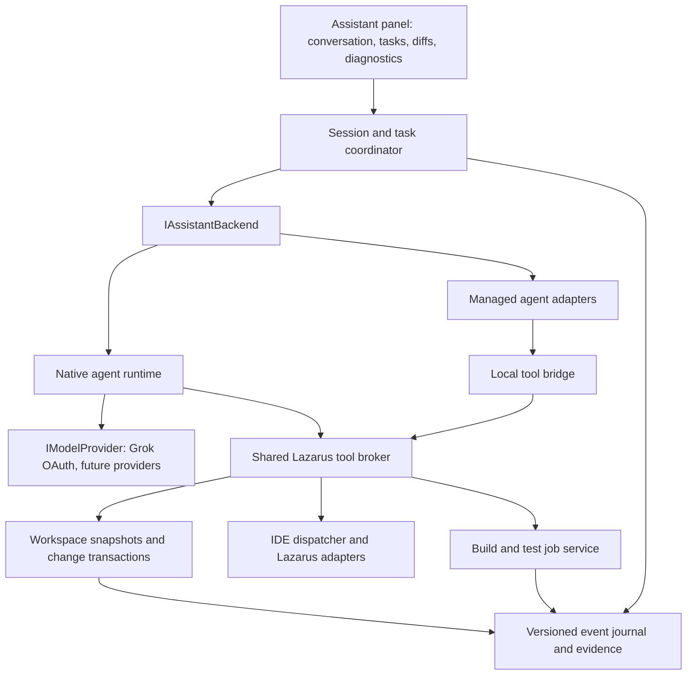

# LazAssistantTools: model extensibility and Lazarus integration revision plan

Prepared: 8 September 2026. Source checkpoint: `1f52527`.

Status: proposed implementation plan, based on static source inspection and current official integration documentation. No assistant implementation changes or live provider tests were performed for this document.

## 1. Recommended direction

Turn LazAssistantTools into a Lazarus development agent with interchangeable backends. Keep the IDE responsible for workspace state, edits, project structure, builds, and review. Allow either the existing native agent loop or an external managed agent to perform the reasoning and orchestration.

**Mandatory requirement, clarified by the user: both Grok and ChatGPT must use subscription-backed access, with no metered API-key calls.** Preserve the existing Grok browser OAuth flow and add ChatGPT through the Codex runtime using ChatGPT account sign-in, subject to the feasibility and release gates below. Direct paid OpenAI/xAI API backends are outside this revision's scope and are not fallback routes.

OAuth describes authentication; API calls describe communication. Subscription-backed clients still make network/API requests. The requirement is that every model request uses the subscription entitlement, rather than a separately billed API account. This applies to chat, builds, summaries, compaction, retries, and child agents. When subscription access is unavailable or its allowance is exhausted, pause and report that state; never switch to metered billing, buy credits, or enable automatic top-ups.

Do not assume a monthly subscription has a single monthly token bucket: the provider controls its included allowances and reset windows. Verify entitlement and active authentication during onboarding and qualification. OAuth alone is not proof of the charging route.

The first useful ChatGPT milestone must read unsaved editor buffers, make genuinely undoable edits, build the correct project revision, and show navigable diagnostics and changes. A chat-only integration, or one that only edits files behind the IDE's back, would not meet the requested objective.

The user-facing target is a sustained workflow: understand the project, propose or execute appropriate changes, use compiler/test feedback, accept steering, and present a reviewable result. The Lazarus-specific advantage should be semantic Pascal operations and coordinated designer/source changes that a filesystem-only agent cannot reliably perform.

This document supersedes the implementation sequence in the earlier [multi-backend plan](LazAssistantTools-Multi-Backend-Plan.md). It also revises the assumptions in the [HTML chat cards plan](LazAssistantTools-Virtual-HTML-Chat-Cards-Plan.md): the current trace renderer uses StyledText controls, and a renderer replacement is not a prerequisite for this work.

## 2. Existing foundations and concrete gaps

The assistant already has an actor loop, streaming, tool execution, steering, plans, workflow events, traces, history, and subagents. Retain these capabilities and extract their responsibilities incrementally; a complete rewrite would discard useful behaviour and complicate regression analysis.

| ID | Finding from current source | Consequence and required revision |
| --- | --- | --- |
| A1 | [AssistantService](../Source/LazAssistantTools/AssistantService.pas), [AssistantActor](../Source/LazAssistantTools/AssistantActor.pas), and [AssistantProtocol](../Source/LazAssistantTools/AssistantProtocol.pas) mix shared orchestration with xAI authentication, endpoint/model defaults, and wire formats. `CompleteOnce` uses its own chat-completions path. | Extract backend and model-provider contracts. Route every request, including summaries and child work, through the selected backend. |
| A2 | In [AssistantSampler](../Source/LazAssistantTools/AssistantSampler.pas), the Responses item-added path records `call_id`, but argument-delta processing can replace it with `item_id`. Input records have both fields; the tool/event path collapses them. | Preserve separate response-item and function-call identifiers throughout parsing, accumulation, and result submission. Add fixtures before changing adapters. |
| A3 | [AssistantActor](../Source/LazAssistantTools/AssistantActor.pas) retains a single encrypted reasoning ID/content pair and reconstructs round input. Its Responses fallback accepts broad HTTP errors including 400/403. | Preserve ordered provider continuation items. Treat authentication, invalid input, and capability errors separately; do not turn ordinary failures into silent protocol switches. |
| A4 | [AssistantConfig](../Source/LazAssistantTools/AssistantConfig.pas) writes OAuth access and refresh tokens to XML. | Introduce credential references and OS credential storage or session-only credentials. Keep runtime-managed authentication owned by the runtime. |
| A5 | `SaveProjectFileText` in [AssistantTools](../Source/LazAssistantTools/AssistantTools.pas) assigns `Ed.SourceText` and reports Undo availability. The local Lazarus editor interface explicitly documents that writing this property clears Undo history. Save failure can still accompany a successful overall result. | Use range edits inside Undo blocks. Separate buffer mutation, disk persistence, and partial failure in tool results. Never claim undoability or persistence without evidence. |
| A6 | The tools mark compilation as requiring the IDE thread. Quiet compilation waits for an external process and first saves all modified project editors. Quiet sessions also suppress disk-change checks for a broad interval. | Dispatch only short IDE operations on the UI thread. Introduce asynchronous build jobs and an explicit source/save policy; narrow suppression to guarded transactions. |
| A7 | Tool schemas, mode checks, thread checks, and execution dispatch are maintained separately in [AssistantTools](../Source/LazAssistantTools/AssistantTools.pas). Active-plan and compile bookkeeping includes global state. | Create one typed tool registry and a workspace-scoped broker. Bind every operation to project identity, generation, and run. |
| A8 | [AssistantIDEContext](../Source/LazAssistantTools/AssistantIDEContext.pas) gathers capped text and runs synchronous Git status with line-based parsing. | Build versioned context snapshots, merge unsaved buffers into retrieval, and reuse the reviewed Git process/parsing infrastructure where suitable. |
| A9 | [ProjectAssistantForm](../Source/LazAssistantTools/ProjectAssistantForm.pas) combines presentation and workflow decisions, including automatic build-work completion after a clean compile. | Move task state and completion evidence into a coordinator. A clean compile alone does not establish that requested behaviour or tests are correct. |
| A10 | [AssistantConversation](../Source/LazAssistantTools/AssistantConversation.pas) is not a complete provider-neutral continuation store. [AssistantTrace](../Source/LazAssistantTools/AssistantTrace.pas) contains a view-object pointer; [AssistantTraceView](../Source/LazAssistantTools/AssistantTraceView.pas) creates card controls. | Version persistence, isolate opaque backend state, remove model-to-view ownership, and bound rendered controls and streaming work. |

These are inspection findings, not claims that every failure has been reproduced. The first implementation phase must turn the important failure paths into executable regression cases.

## 3. Integration choices and feasibility gates

### 3.1 Distinguish a model from an agent runtime

A model API generates responses and requests tools; LazAssistantTools must own the loop, retries, tool scheduling, context management, and continuation. A managed agent already owns much of that loop. Both should fit the product, but they must not be forced into an identical low-level sampler interface.

| Backend | Execution owner | Authentication and intended role |
| --- | --- | --- |
| Existing Grok OAuth access | Native Lazarus agent | Preserve browser OAuth and subscription entitlement behind the xAI adapter; verify the charging route in P0. No API-key fallback. |
| ChatGPT / Codex | Managed runtime | Required ChatGPT subscription sign-in, reusing the runtime harness, subject to qualification. Reject API-key authentication. |
| Future model APIs, including local models | Native Lazarus agent | Additional adapters with tested capabilities and explicit entitlement metadata. Metered providers are outside this revision; models without tool support remain chat-only. |
| Optional Grok Build runtime | Managed runtime | Evaluate ACP integration after the initial architecture spike; do not make it a prerequisite for ChatGPT. |

ChatGPT sign-in provides subscription access; API-key sign-in uses separately billed API access and must be rejected for this integration. Qualify the runtime's `forced_login_method = "chatgpt"` setting and check the active authentication method before starting work. Availability must be checked against the user's account; the application must not promise a particular allowance. Codex can use a credential file or an OS credential store, so launching it does not itself guarantee encrypted credential storage. [OpenAI authentication documentation](https://learn.chatgpt.com/docs/auth)

The current App Server documentation describes a bidirectional local protocol, thread/turn operations, approvals, and generated schemas. It also explicitly labels the `app-server` command experimental and unsupported for production workloads; dynamic tools are experimental too. Therefore, use a pinned, tested version for a development preview and record a production-readiness decision before general release. Do not inherit the earlier plan's assumption of a stable production interface. [OpenAI App Server documentation](https://learn.chatgpt.com/docs/app-server)

Grok Build documents both an agent interface and ACP embedding in other applications. This makes runtime reuse worth evaluating alongside the native xAI path. It does not establish parity with the user's experience or prove compatibility with Lazarus tools; those require a prototype and task comparison. [Grok Build overview](https://docs.x.ai/build/overview)

### 3.2 First spike: prove the difficult path

Time-box an end-to-end prototype before substantial UI work:

1. Start a pinned Codex runtime, complete initialization and sign-in, discover models, and stream a turn.
2. Expose a minimal Lazarus tool that reads an unsaved buffer through the IDE dispatcher.
3. Execute a version-checked edit through the broker; demonstrate that Lazarus Undo restores it.
4. Run a build asynchronously and return diagnostics associated with that edit.
5. Exercise approval, steering, cancellation, runtime failure, and IDE/project closure.
6. Determine whether built-in filesystem and shell tools can be constrained so they cannot bypass the IDE edit policy.
7. Verify subscription-backed usage for both Grok and ChatGPT. Exercise expired sign-in, exhausted allowance, and an inherited API-key environment/configuration; reject metered credentials and ensure auxiliary requests stay on the subscription route. Do not use stored secrets as test output.

Prefer an isolated local MCP bridge when the chosen runtime supports the required behaviour. Codex documents local stdio MCP servers; use that as a transport option, not as proof that every lifecycle or approval requirement is satisfied. [OpenAI MCP documentation](https://learn.chatgpt.com/docs/extend/mcp)

A possible implementation is a small stdio bridge process connected to the running IDE through a private Unix socket or named pipe. Use a per-instance handshake, restricted endpoint permissions, and project-generation checks. Keep all tool semantics in the IDE broker so native and managed backends share implementation. Avoid opening an unauthenticated network service.

If MCP cannot provide the required integration, evaluate experimental dynamic tools against the pinned runtime. If neither route passes, keep ChatGPT integration blocked or in preview while seeking a supported subscription-compatible integration. A paid OpenAI API adapter does not satisfy the requirement and must not replace it. If a runtime cannot prevent direct writes to live project files, restrict it to a staging workspace and import reviewed changes through the broker; do not advertise that as full live-editor integration.

## 4. Proposed architecture

The coordinator owns the user task and UI lifecycle. Exactly one runtime owns the model/tool loop for a run. A managed runtime's tool request is executed once through the broker; the native actor must not independently interpret the same output and execute it again.

### 4.1 Contracts and suggested units

Names below are proposed boundaries, not a requirement to create one unit per tiny type.

| Boundary | Responsibilities |
| --- | --- |
| `AssistantBackendTypes` | Backend/profile/model identifiers, capability records, normalized commands/events, error categories, usage, and immutable payload ownership. |
| `IAssistantBackend` | Open/resume session, start turn, steer, cancel, answer pending user/approval requests, expose status/capabilities, and close. Operations return asynchronously. |
| `IModelProvider` | Serialize native-runtime requests, stream model events, preserve provider continuation state, and report model capabilities. No Lazarus or UI dependencies. |
| `AssistantNativeBackend` | Adapt the existing actor/service loop; own native tool rounds, retries, compaction, and child runs. |
| `AssistantXaiProvider`, future provider adapters | Provider authentication integration, transport details, model discovery, request options, and wire parsing. Share transport utilities only where semantics actually match. |
| `AssistantCodexBackend` | Process/protocol lifecycle and translation between managed events and shared events. No duplicate native agent loop. |
| `AssistantToolRegistry`, `AssistantToolBroker` | Tool descriptors, schema validation, permissions, workspace checks, execution dispatch, cancellation, and result receipts. |
| `AssistantWorkspace`, `AssistantChangeSet` | Editor/disk snapshots, revisions, edit preparation/application, conflict handling, and change review. |
| `AssistantIDEAdapter`, `AssistantCodeToolsAdapter`, `AssistantDesignerAdapter` | Version-sensitive Lazarus operations behind mockable interfaces. |
| `AssistantBuildService`, `AssistantTaskCoordinator` | Asynchronous validation and task-specific completion evidence. |
| `AssistantSessionStore`, `AssistantContextManager` | Durable sessions, continuation references, retrieval, and context budgets. |

The UI must not import provider authentication units or construct provider request JSON. One-shot summarization must use the same selected profile and capability checks as conversation requests.

### 4.2 Capability-driven configuration

Separate backend identity, account profile, model ID, model options, and runtime version. Discover available models where supported, supplement discovery with explicit adapter metadata and contract tests, and permit a configured model identifier without assuming its capabilities from its name.

Represent authentication kind and entitlement/billing route separately from model capabilities. Subscription-only is enforced policy for this revision; unknown or metered routes cannot start a model request. Represent at least: tool calling, streaming, images, structured output, supported reasoning settings, context limits, usage reporting, steering, resumable sessions, parallel tools, and execution ownership. Hide unsupported controls and explain unavailable actions. Do not send a hard-coded reasoning level to every model.

Changing the selected provider starts a new session or branches from a neutral summary. It must not replay one provider's encrypted reasoning, internal tool items, or server state into another provider. Freeze the active run's profile so a settings change cannot redirect a running task.

### 4.3 Event and lifecycle rules

Every event carries a session ID, run ID, workspace ID, project generation, sequence, and relevant request/tool identifiers. Buffer operations additionally carry revision preconditions. Events distinguish text, public reasoning summaries where available, tool progress, approval/input requests, usage, and terminal outcomes. Do not promise raw model chain-of-thought.

Use a defined run state machine: idle, preparing, running, waiting for user, cancelling, completed, failed, cancelled. Terminal delivery is idempotent. Late callbacks cannot update a new project or resurrect a closed session. Own copied event payloads; do not queue references to short-lived threads or JSON objects.

The IDE dispatcher executes short, bounded main-thread operations. Network/process waits and pure snapshot processing run outside the UI thread. Serialize IDE and CodeTools access where required; do not assume the global CodeTools manager is thread-safe. Closing the IDE must cancel work, detach callbacks safely, and close runtime processes without an unbounded wait.

### 4.4 Existing Responses-format protocol correctness

These wire-format fixes apply to the existing native adapter; they do not require implementing a metered OpenAI backend. Keep response item IDs separate from tool `call_id` values, and return function results using the latter. Preserve the ordered output/continuation items needed by the provider, including multiple opaque reasoning items when applicable. Do not recreate provider state from the visible conversation alone. These distinctions follow the documented function-calling lifecycle. [OpenAI function calling](https://developers.openai.com/api/docs/guides/function-calling)

Test fragmented SSE input, multiple simultaneous calls, Unicode, repeated argument substrings, empty deltas, final snapshots, interrupted streams, and duplicate terminal events. Distinguish append events from replacement snapshots rather than applying one text-merging heuristic to all payloads. Retry only operations whose effects can be reconciled; never replay a completed mutating tool merely because the next network response failed.

## 5. Lazarus tool layer

### 5.1 One registry and one enforcement point

Each descriptor supplies name/version, input and result schema, effect category, allowed modes, required IDE capability, thread requirements, cancellation behaviour, and required preconditions. Generate model declarations and UI summaries from this registry. Validate again at execution time regardless of which backend requested the tool.

Use effects such as read, edit buffer, change project/designer, build/test, execute process, and external side effect. Preserve Ask/Plan/Build semantics, but enforce them in the broker. A planning task may write its designated plan artifact without receiving arbitrary project-edit permission.

Authorization should cover a meaningful task scope and its ordinary edits/builds, avoiding repeated prompts for every small operation. Ask again when the scope materially expands. Show a concrete diff or command and purpose when approval is needed. Runtime sandbox settings do not replace checks on IDE-hosted tools.

### 5.2 Tool families and implementation order

| Family | Proposed operations | Lazarus implementation and limits | Release |
| --- | --- | --- | --- |
| Workspace/context | Project identity, build mode, files, open buffers, selection, revisioned read/search, changed files | `LazIDEIntf`, `ProjectIntf`, `SrcEditorIntf`; merge dirty buffers over disk results | First useful release |
| Navigation | Open location, jump to declaration, find references, retrieve symbol context | Source-editor navigation and `CodeToolBoss.FindDeclaration` / reference APIs | First useful release for basic navigation; expand later |
| Editing | Prepare/apply range edits, create unit, inspect diff, save authorized files | `ReplaceText`, `BeginUndoBlock` / `EndUndoBlock`; existing project APIs for unit registration | First useful release |
| Validation | Build/check, collect diagnostics, stop job, run configured tests | IDE build lifecycle or controlled `lazbuild` worker; target/build-mode-aware configuration | Build first; test adapters next |
| Semantic refactoring | Rename symbol, modify uses, generate/complete declarations, inspect dependencies | CodeTools with project defines and search paths; preview resulting edits | Semantic release |
| Forms/designers | Inspect component tree, add/remove component, set published property, create event handler | `FormEditingIntf`, RTTI, CodeTools and `.lfm` coordination | Semantic release |
| Project/packages | Add/remove project unit, inspect options and dependencies, controlled package changes | `ProjectIntf`, `CompOptsIntf`; qualify package APIs for supported Lazarus versions | Basic unit operations first; broader changes later |
| Runtime/debugging | Launch/stop, breakpoints, stopped-frame inspection, watches | Version-qualified debugger interface adapters; initially read-only inspection while stopped | Later extension |

The names above describe product operations. Confirm exact signatures against each supported Lazarus version before exposing them as a public tool contract. Do not equate debugger expression evaluation with harmless reading; some evaluations can execute code.

### 5.3 Buffer-first edit transactions

1. **Snapshot:** capture text, encoding/newline information, editor revision, disk fingerprint, and project generation. Open editor content is authoritative for an open buffer.
2. **Prepare:** produce precise range edits or semantic changes against that snapshot. Include a readable diff, affected resources, and save requirements.
3. **Validate:** reject stale revisions, conflicting edits, out-of-workspace paths, and unsupported designer/project changes. Resolve canonical paths and symlinks according to the existing project policy.
4. **Apply:** make editor range changes inside Undo blocks, preserving existing user history. Apply non-overlapping ranges in a safe order. Convert provider offsets explicitly to Lazarus coordinates; the inspected interface uses one-based byte/line cursor positions.
5. **Persist if authorized:** distinguish applied-to-buffer from saved-to-disk. Do not save unrelated user modifications as a side effect of a build.
6. **Record:** journal actual changed revisions and save results. If only part succeeds, return a partial outcome with a recovery action, not unconditional success.

Multi-file operations are logical transactions, not an assumption that the IDE or filesystem offers atomic multi-file writes. Prepare all changes before mutation, maintain an inverse change set, and restore only assistant-owned changes whose revisions still match. Never use a whole-worktree reset to undo an assistant edit. Native Undo is normally per editor; any “Undo task” action must reconcile all files explicitly.

Retain the current protection against raw `.lpi`/`.lps` source overwrites. Route project metadata through IDE APIs. Limit disk-change-check suppression to the necessary transaction and restore it in `finally` handling.

### 5.4 Pascal semantics and visual designer control

CodeTools requests must run with the actual project/build-mode defines, unit/include paths, language mode, and source buffers. Prefer declaration/reference APIs over text matching for renames; account for overloads, conditional compilation, unit-qualified references, and references in form resources. Do not run global CodeTools operations concurrently without a proven isolation mechanism.

Replace progressively the textual shortcuts in `ensure_form_component`. First support a well-defined subset: ordinary forms, installed component classes, explicit parent/owner, supported published properties, and event methods. A single change set must keep component names, Pascal fields, uses clauses, handler signatures, and `.lfm` bindings consistent.

Inherited forms, frames, data modules, collections, and streamed properties need separate qualification cases. Unsupported operations should return a precise limitation without guessing at resource text. Verify each supported designer operation by reopening the resource, exercising Undo, and building the project. Do not claim arbitrary component support from a successful `TButton` demonstration.

## 6. Build-style task execution and user experience

### 6.1 A continuous development loop

The coordinator should support: inspect → establish acceptance criteria → edit → build/test → diagnose → repair → review. Users can steer an active task without losing its state. The task records what was requested, the current step, changed resources, outstanding decisions, and evidence still needed.

Retain the existing plan/todo workflow, but move completion decisions out of the form. The model proposes completion; the coordinator checks required evidence. For a compile repair, a clean build may suffice. For a behavioural change, relevant tests or an explicit manual validation result are also needed. A clean build before subsequent source changes is stale evidence.

Bound native loops by configurable time, rounds, and spend where available. Reaching a limit yields a resumable paused outcome with remaining work. Managed runtimes retain their own loop and compaction ownership; the coordinator supplies task policy and records progress rather than starting another hidden loop.

### 6.2 Asynchronous builds and trustworthy diagnostics

Give each build a job ID, workspace generation, target, build mode, command/configuration identity, and source-revision manifest. Choose an explicit input policy: save the authorized changed buffers, request a decision for other necessary unsaved changes, or build a consistent staging snapshot. Never quietly compile stale disk files while reporting success for newer editor contents.

Prefer IDE build hooks when they provide adequate asynchronous lifecycle and diagnostic correlation. Otherwise launch `lazbuild` through a worker with structured arguments, bounded output, timeout, and process-tree cancellation. Register completion callbacks before launch and keep the UI responsive.

Return structured diagnostics with filename, position, severity, message, build ID, and raw-log reference. Display them in the assistant and provide navigation into the editor; integrate with the IDE message surface where its API supports it. Do not treat unrelated global IDE messages as this build's result. Preserve test failure separately from compilation success.

### 6.3 Context and memory

Use a context manager that assembles a small initial snapshot: project/build identity, user-selected code, relevant symbols, recent diagnostics, current diff, and applicable repository instructions. Provide targeted retrieval for the rest. Tag retrieved content with origin and revision so the model can request a refresh after edits.

Search must include unsaved buffers. Move Git discovery off the UI thread and reuse robust status parsing rather than parsing quoted filenames ad hoc. Budget by provider-reported limits where possible, retaining estimates as estimates. Compact decisions, acceptance criteria, unresolved issues, and tool evidence while preserving valid call/result relationships.

Keep repository content and tool output distinguishable from user authority. A comment or generated log must not grant new tool permissions. Avoid indexing or transmitting credentials and unrelated private files by default. Embeddings and a large persistent index are optional later optimizations, not prerequisites for useful Pascal context.

### 6.4 Interaction and rendering

Show a clear active step, tool purpose, affected files, elapsed time, and a persistent Stop control. Provide inline diffs, diagnostic links, collapsible logs, task status, and a concise completion report with validation evidence. Surface provider/model/account-route selection plainly without exposing protocol implementation details in the main conversation.

Keep StyledText initially. Separate trace data from view objects, coalesce streaming updates, and virtualize or lazily mount old cards if measurement shows a need. Preserve selection, copy, keyboard navigation, scroll anchoring, and automatic scrolling only while the user is following the tail. Reconsider HTML only after a prototype demonstrates a meaningful benefit over the current renderer.

Suggested local performance targets, to calibrate in the baseline phase: acknowledge user input within 250 ms; keep ordinary IDE dispatch work below 50 ms at the 95th percentile; throttle visual stream updates to at most about 20 Hz; show cancellation immediately and terminate supported local workers within two seconds. Model/network latency is measured separately and cannot be guaranteed by the panel.

### 6.5 Persistence and credentials

Use a versioned event journal with periodic snapshots, backend/profile identity, task state, changed-file receipts, and evidence references. Store provider continuation data separately from the neutral display history. Preserve old conversations through migration or read-only import; do not require destructive conversion.

On restart, reconcile pending tools against recorded receipts and current buffer/disk revisions before offering resume. An interrupted write is an unknown outcome until checked, not a reason to repeat it. If remote state has expired, offer a new session based on the saved summary and evidence.

Store credential references in configuration. Use platform credential services where available and session-only entry otherwise; never silently fall back to plaintext XML. Migrate existing tokens only after the new store succeeds, and avoid leaking them through backups, logs, crash reports, or trace exports. Let managed runtimes own their credentials and expose actionable storage/configuration status without importing their tokens.

## 7. Delivery sequence and logical commit groups

Each work package should be delivered through small, buildable commits with focused tests. Preserve the functioning xAI path until the replacement passes parity checks. The day ranges below are rough engineering effort for one developer familiar with Lazarus, excluding external API changes and extended cross-platform qualification; recalibrate after P0.

| Package | Deliverables and logical groups | Dependencies | Exit criteria | Estimate |
| --- | --- | --- | --- | --- |
| P0 — Baseline and integration spike | Record representative projects/tasks; add protocol and Undo reproductions; prototype managed runtime → IDE tool bridge; record version/support decision | None | Unsaved-buffer read/edit/build demonstrated; runtime write bypass and production-support risks resolved or explicitly gated | 3–5 days |
| P1 — Contracts and xAI extraction | Shared types/capabilities; xAI adapter; native backend; unified one-shot path; ID/continuation/fallback fixes; credential boundary | P0 | Existing xAI scenarios pass through the new interfaces; no provider JSON/auth in shared UI | 5–8 days |
| P2 — Workspace and tool broker | Registry; scoped policy; IDE dispatcher; revisions/change sets; undoable edits; save outcomes; project-switch cancellation | P1 | Both direct and bridge callers use the same validated edit path; stale edits are rejected | 6–10 days |
| P3 — ChatGPT preview | Pinned process/protocol adapter; account/model settings; bridge; streaming/steering/cancel; minimal versioned session persistence | P0, P2 | ChatGPT completes the first useful IDE workflow; no silent billing fallback or tool bypass | 5–9 days |
| P4 — Build and evidence loop | Async builds; source manifests; diagnostics; task criteria; basic FPCUnit/configured test runner; completion report | P2; integrate with P3 | Correct revision is validated; failed tests/stale builds prevent false completion; UI stays responsive | 5–8 days |
| P5 — Subscription enforcement | Grok and ChatGPT entitlement checks; reject API-key environments/configuration; quota pause/resume; auxiliary-request and child-run coverage | P1, P3 | Both backends use subscription access throughout; missing/exhausted entitlement never triggers metered requests | 3–5 days |
| P6 — Pascal and designer depth | CodeTools navigation/refactoring; project operations; scoped designer support; paired source/resource transactions | P2, P4 | Rename and form-event acceptance projects pass, including conflict and Undo cases | 8–14 days |
| P7 — Context and interaction | Snapshot retrieval; steering/task presentation; diff and diagnostic cards; bounded rendering; lifecycle/persistence hardening and migration | P3, P4 | Long sessions remain usable and resumable; relevant dirty buffers appear in context | 5–9 days |
| P8 — Qualification and release | Cross-platform IDE/runtime matrix; failure injection; end-to-end benchmarks; user/developer documentation; support gate | P5–P7 | Release acceptance matrix passes and managed-runtime support status is explicitly documented | 4–7 days |

P3 and P4 together define the first useful ChatGPT preview. Deliver the essential credential, persistence, diff, and cancellation pieces in those packages; P7 expands them rather than postponing correctness until later. Subscription authentication and billing-route checks are essential to P0/P3; P5 broadens the failure and lifecycle coverage. If the managed-runtime gate fails, continue subscription-compatible integration research rather than substituting paid API access.

The estimates total approximately 44–75 engineering days before optional extensions. They are a planning range, not a delivery promise. The first useful preview is roughly 24–40 days on this sequence; the spike may materially reduce or increase that range.

Later, separately scoped packages: debugger integration, richer component editors, package dependency operations, additional model providers, and optional Grok Build ACP. Introduce parallel child work only after workspace ownership is reliable: independent reads can overlap, but shared-buffer writes must serialize or use isolated workspaces with reviewed integration. Do not combine native and managed subagent schedulers for the same run.

## 8. Verification and acceptance matrix

Extend the existing [assistant test programs](../Source/Tests/AssistantSamplerTest.lpr) and add focused boundary tests. Use fake providers/runtime transcripts for repeatability and a small Lazarus test project for editor/designer/build integration. Live model tests should be opt-in, record account route/model/runtime version, and avoid requiring credentials in ordinary CI.

| Scenario | Required evidence |
| --- | --- |
| Existing xAI workflow | Chat, planning, tool use, cancellation, and conversation loading remain functional after extraction. |
| ChatGPT workflow | Account sign-in, model selection, unsaved-buffer read, edit, build, diagnostics, review, and resumed session work through the qualified runtime. |
| Subscription-only operation | Grok and ChatGPT use their subscription entitlements; inherited API keys, expired login, and exhausted allowance cause a clear pause/error, never metered fallback. Summaries and child runs follow the same rule. |
| Native protocol regression | Tool outputs reference the correct call IDs; multi-call and continuation fixtures pass on the existing Grok adapter. |
| Unsaved Unicode source | Edit and navigation positions are correct for multibyte text and mixed newline cases; Undo preserves pre-existing user history. |
| Concurrent user edit | A prepared assistant change is rejected or rebased explicitly when the user changes the buffer before application. |
| Project switch or IDE close | Queued events/tools cannot operate on the next project; workers exit and late callbacks are harmless. |
| Save failure | Buffer change and disk failure are reported separately; no false saved/build-complete claim. |
| Compiler repair | Introduce a known error, obtain a correctly located diagnostic, repair it, and validate the resulting revision. |
| Failed behavioural test | A clean compile with a failed FPCUnit/configured test remains incomplete. |
| Semantic rename | Correct declaration and references change under the selected build configuration; unrelated same-name text remains intact. |
| Designer event | Add a component and handler; Pascal and `.lfm` agree; reopen, build, and Undo succeed. |
| Cancel and disconnect | Cancel during stream/tool/build and lose runtime connection mid-operation; no duplicated mutations or orphaned jobs. |
| Mode and tool policy | Read-only runs reject writes even when a backend explicitly requests them; managed built-ins cannot bypass the broker's workspace policy. |
| Persistence and migration | Legacy conversations remain readable; interrupted operations reconcile; provider switches do not replay opaque foreign state. |
| Long conversation | A large trace with streaming, code blocks, and collapsed logs stays responsive with bounded mounted controls and no scroll jumps. |

Compare representative tasks with Grok Build using the same project snapshots and equivalent requests. Record completion rate, manual interventions, invalid edits, diagnostic repair cycles, elapsed time, and usage where reported. Compare outcomes and ergonomics; do not promise exact parity from a feature checklist or compare different models as though only the UI differed.

Release blockers include lost user edits, cleared Undo history, wrong-project operations, duplicate tool effects, false validation success, secret leakage, any metered model request, and an unconstrained runtime bypass of live-editor policy. Lesser UI polish issues should not obscure these correctness gates.

## 9. Main risks and decisions

| Risk or unresolved choice | Planned resolution |
| --- | --- |
| Experimental managed-runtime interface changes | Pin version, capture its schema/transcripts, detect compatibility at startup, and retain a release gate. Do not describe preview support as production-supported. |
| Agent writes bypass live buffers | Prove tool restrictions in P0; otherwise staging import under subscription authentication, or leave the integration gated. |
| Lazarus interfaces differ by version/platform | Isolate adapters, declare a supported matrix, and test the actual installed IDE/compiler combinations. |
| Refactoring/designer operations cause partial changes | Prepare complete change sets, verify revisions, journal outcomes, and qualify a limited operation subset before expansion. |
| Thread/lifecycle complexity grows during extraction | Single run owner, bounded queues, explicit project generation, short IDE dispatch, and failure-injection tests. |
| Scope expands into rebuilding every agent feature | Reuse managed orchestration where qualified; prioritize reliable Pascal operations and measurable task outcomes. |
| Provider extensibility becomes a lowest-common-denominator API | Separate runtime and model-provider layers; expose capabilities and adapter-owned continuation rather than generic JSON passthrough everywhere. |

The account-route decision is settled: subscription-backed Grok and ChatGPT only. If a prototype cannot meet that requirement, report the integration limitation and continue investigating a compatible route; do not ask to substitute metered API calls as a routine fallback. Runtime version and supported Lazarus platforms are engineering decisions to record during P0, not assumptions to hide in source code.

## 10. Source and API evidence

Repository links in the findings identify inspected implementation units. Additional relevant foundations are [AssistantHarness](../Source/LazAssistantTools/AssistantHarness.pas), [AssistantPlan](../Source/LazAssistantTools/AssistantPlan.pas), [AssistantEvents](../Source/LazAssistantTools/AssistantEvents.pas), [AssistantLfm](../Source/LazAssistantTools/AssistantLfm.pas), and [AssistantProjectPaths](../Source/LazAssistantTools/AssistantProjectPaths.pas).

Lazarus API checks used the local checkout at `/home/paul/Projects/FreePascal/Lazarus`. These paths and method anchors document what was verified; supported release versions must still be qualified:

- `components/ideintf/srceditorintf.pas`: `ReplaceText`, `BeginUndoBlock`, `EndUndoBlock`, `CursorTextXY`, and the explicit `SourceText` Undo-clearing comment.
- `components/ideintf/lazideintf.pas`: `DoOpenFileAndJumpToPos`, `DoSaveProject`, `DoBuildProject`, project lifecycle handlers, and build-finished handlers.
- `components/codetools/codetoolmanager.pas`: `FindDeclaration`, `FindReferences`, `FindReferencesInFiles`, `RenameIdentifier`, `RenameIdentifierInLFMs`, and `CompleteCode`.
- `components/ideintf/formeditingintf.pas`: `CreateComponent` and `CreateComponentFromStream`; broader designer semantics remain a qualification task.

Official provider sources are linked beside the decisions they support and were consulted on 8 September 2026. The architecture, sequencing, estimates, and acceptance criteria are recommendations derived from the repository review, not vendor guarantees.
