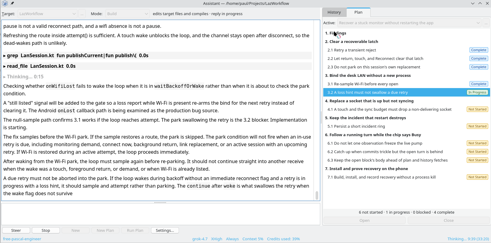
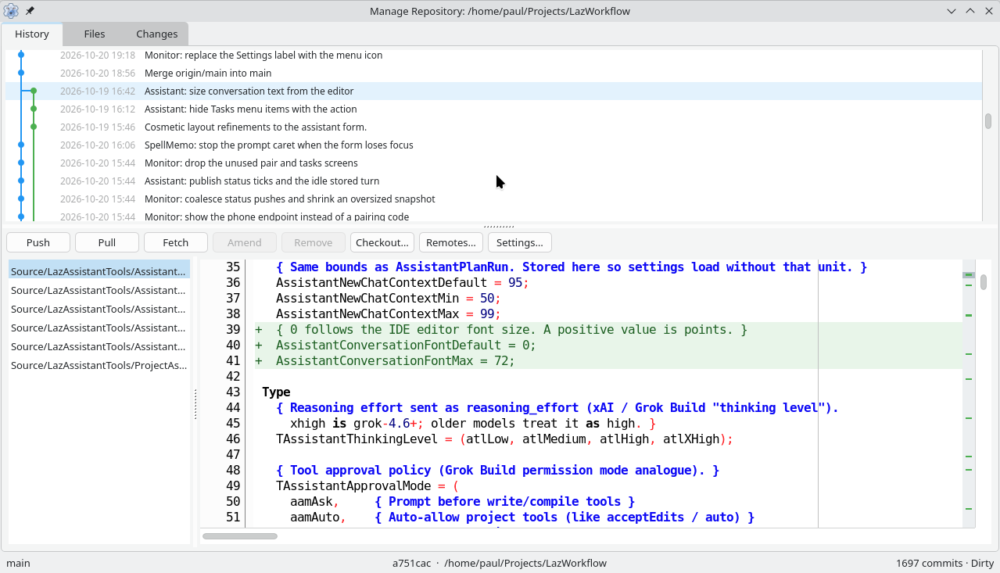
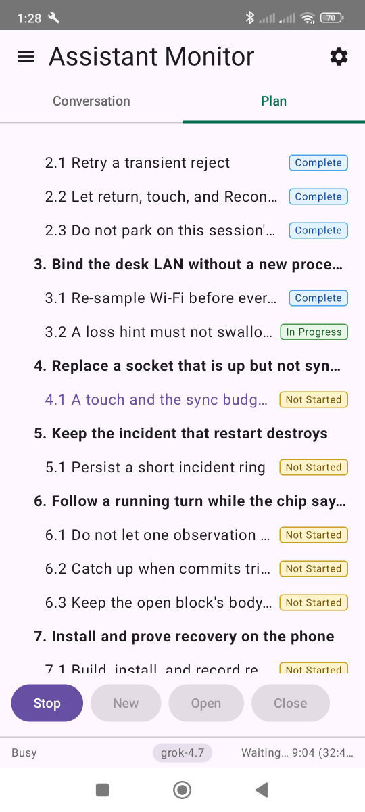

# LazWorkflow

**AI-assisted Pascal programming inside the Lazarus IDE.**

LazWorkflow is a set of Lazarus packages that put an AI coding assistant and a full Git client inside the IDE you
already use. The assistant does more than chat. It reads your units, finds declarations through CodeTools, edits files,
adds components to forms, compiles with the IDE's own build, runs your tests, and works through a written plan one item
at a time. Edits that need your approval wait for you.

If you write Object Pascal and want to try AI-assisted development without moving to VS Code or giving up the LCL form
designer, this project is for you.



*The Project Assistant in Build mode, part way through a plan. The conversation and tool calls are on the left. The plan
on the right tracks each item as Not Started, In Progress, Blocked or Complete.*

## Why use an assistant inside Lazarus?

General AI coding tools know little about Lazarus. They cannot see your `.lpi`, they do not know which units the IDE has
open, they cannot keep an `.lfm` in step with its `.pas`, and they guess at whether the code compiles. LazWorkflow gives
the model the same view of the project that you have:

- **The IDE's own build.** The assistant compiles through Lazarus and reads the compiler messages, so it can fix its own
  errors before it reports that the work is done.
- **CodeTools navigation.** `find_declaration`, `find_references` and `symbol_context` use the IDE's parser, not text
  search, so the model can follow a symbol across units and packages.
- **Form-aware editing.** `ensure_form_component` and `add_unit_to_project` change forms and projects the way the IDE
  would, keeping the streamed fields and the `.lfm` object tree in step.
- **Live editor context.** Each message can include the active editor and the project file list, so you can ask about
  "this procedure" without pasting it in.
- **Your own house style.** Skills are Markdown documents that you write, such as a Pascal style guide or a review
  checklist. You choose which skills are sent in which mode.

## What is included

| Package | What it gives you |
|---|---|
| **LazAssistantTools** | The Project Assistant: chat, plans, tasks, tool approvals, live Markdown windows, and compiler integration. |
| **LazRepositoryTools** | Git inside the IDE: commit history graph, diffs, staging, push and pull, remotes, clone, init and `.gitignore`. |
| **LazAssistantMonitor** | A remote monitor. Follow and steer a running assistant turn from your phone over the local network. |
| **LazStyledText** | Styled edit, memo and virtual-list controls with a compact Markdown loader. You can use these in your own applications. |
| **LazWorkflowCommon** | Shared foundation: event bus, logging, spell checking (Hunspell, Aspell, Windows), and UI helpers. |

### Project Assistant

- **Several model providers.** You set up one or more connections and choose one for each chat:
  - **Grok** (xAI), signed in with a SuperGrok or X Premium account, with live search and citations.
  - **ChatGPT**, through the Codex app, using your ChatGPT account.
  - **Claude**, through the installed Claude Code program on your Claude subscription. Lazarus tools are offered to
    Claude Code through a built-in MCP broker, so edits, builds and Git still go through the IDE and its approval
    dialogs.
  - **Any OpenAI-compatible endpoint**: OpenRouter, or a local server running your own models.
- **Modes that match how you work.** Chat, Inspect, Document, Plan and Build. Each mode gives the model a different set
  of tools. Inspect can read but not change anything. Build can edit, compile and run.
- **Plans you can read.** In Plan mode the assistant writes a Markdown plan into `Documents/`, with numbered sections,
  items and acceptance checks. *Run Plan* then works through it item by item and records progress in the plan file, so
  you can stop, review or edit the plan, and continue later.
- **Approval you control.** Choose for each connection whether to ask before each write or compile, auto-approve
  project tools, or never ask. Requests appear as ordinary IDE dialogs.
- **Subagents.** The assistant can hand work to focused helpers: Explore, Plan, General, and Pascal-specific Naming,
  Structure and Review agents.
- **Recovery.** Credit limits, dropped connections and context limits are handled with retries, automatic continuation
  and auto-compaction. A plan can continue in a new chat when the context fills up.
- **Readable output.** Conversations, thinking and tool calls are drawn with the LazStyledText controls: Markdown,
  tables and syntax-highlighted code, at the IDE's editor font size or your own.

### Repository Manager



A Git client built for Lazarus: a commit graph with branches and merges, history, files and changes views, a
syntax-highlighted diff, and the everyday commands (push, pull, fetch, amend, checkout, remotes). It is useful by itself,
and especially useful for reviewing what the assistant has just changed before you commit it.

### Assistant Monitor



Long plan runs do not need you at the desk. The monitor pairs the IDE with an Android phone app over your local network
using TLS and a one-time pairing code. From the phone you can follow the conversation and the plan as they update,
approve tool calls, send a message, or stop the turn.

The phone app is in `Source/KotlinMonitorApp/`. The phone never calls a model and never runs a tool; everything still
happens in the IDE.

<br clear="right">

## Getting started

### Requirements

- Lazarus and Free Pascal. The project is developed against Lazarus `main` and FPC 3.3.1.
- Git on your `PATH`, for the Repository Manager.
- At least one model account: a Grok account, a ChatGPT account with the Codex app installed, a Claude subscription with
  Claude Code installed, or an OpenAI-compatible endpoint.

### Install the packages

1. Clone the repository:

   ```sh
   git clone https://github.com/PaulMichell/LazWorkflow.git
   ```

2. In Lazarus, open each package from `Packages/` with *Package → Open Package File (.lpk)* and choose
   *Use → Install*, in this order:

   1. `LazStyledText.lpk`
   2. `LazWorkflowCommon.lpk`
   3. `LazRepositoryTools.lpk`
   4. `LazAssistantTools.lpk`
   5. `LazAssistantMonitor.lpk` (optional, for the phone monitor)

3. Rebuild the IDE when asked. After any later change to a package, rebuild with *Tools → Build Lazarus* to see it.

### Your first assistant session

1. Open a project and open the Project Assistant.
2. Choose *Settings…*, add a connection, and sign in.
3. Pick a mode. Start with **Inspect** and ask about your own code: *"What does `TMainForm.LoadSettings` do, and where
   is it called?"*
4. When you trust the answers, switch to **Build** and ask for a small change. Watch the tool calls, approve the edits,
   and let it compile.
5. For anything larger, use **Plan** first, read the plan it writes, then press *Run Plan*.

### Tips for Pascal programmers new to AI tools

- **Be specific.** Name the unit, class or form, and say what "done" means, for example "it compiles and the test
  passes".
- **Write down your conventions.** A short style document added as a skill does more than repeating rules in every
  prompt. `Documents/free-pascal-engineer.md` is the one this project uses.
- **Review before you commit.** The Repository Manager shows every change as a diff. The assistant is fast, but you
  are still the engineer.
- **Plans are documents.** Edit them. Delete an item you do not want, or add an acceptance check before you run it.

## Building and testing

The tests are run with a single script, which also builds every package:

```sh
instantfpc Tests/RunAssistantTests.pas --lazarus-root /path/to/lazarus \
  --only AssistantClaudeClientTest --output-dir Temporary/run1
```

`--only` may be repeated. Add `--gui` for the GUI tests, which need a display. Leave out `--only` to run everything.

## Project layout

```text
Packages/    Lazarus package files (.lpk)
Source/      Package sources, the Android monitor app, and tools
Tests/       Test programs, fixtures and the test runner
Documents/   Plans, the Pascal style guide, and screenshots
```

## Status

LazWorkflow is under active development and the packages are at version 0.1. Expect changes to settings and to the
monitor protocol between versions. The assistant has been used to develop much of this repository, and its plans are
in the Git history.

## Licence

LGPL-2.1-or-later with the static linking exception, as used by the Lazarus LCL.

© Michell Computing
